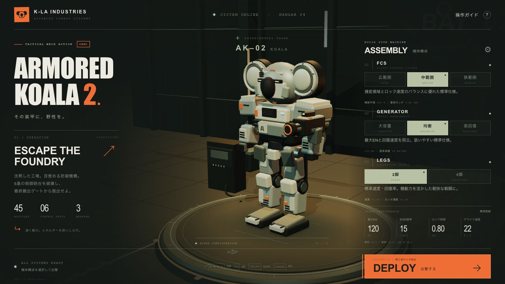

# ARMORED KOALA 2 — DEMO

Three.js で作った、コアラ型戦闘機械の TPS 脱出アクションです。格納庫で FCS・ジェネレーター・脚部を選び、廃工場の制御砲台を破壊して搬出ゲートへ向かいます。実行時の外部 API、CDN、画像、モデル、音声の取得はありません。3D の機体と工場はコードで生成します。

## 起動

Node.js 20.19+ または 22.12+ を使用してください。

```sh
npm ci
npm run build
npm run dev -- --host 0.0.0.0 --port 5173
```

ブラウザで http://localhost:5173 を開き、DEPLOY をクリックしてください。キーボード・マウスと WebGL 2 / Pointer Lock 対応デスクトップブラウザを使用します。1280×720 以上を想定しています。初期構成は中範囲 FCS・均衡ジェネレーター・2脚です。

この作業環境では5173が既存プロジェクトで使用中のため、確認用サーバーは **http://localhost:5175** で起動しています。内蔵ブラウザは Pointer Lock API に非対応だったため、実際の操縦には対応する外部ブラウザを使用してください。

`?seed=20260908` で 32bit 符号なしシードを指定できます。未指定時も 20260908 です。依存関係はバージョンを固定して lockfile を同梱しています。

## 操作

| 入力 | 動作 |
| --- | --- |
| WASD / マウス | カメラ基準の移動 / 視点・照準 |
| Space 短押し / 0.20 秒長押し | ジャンプ / 飛行（20 EN/秒） |
| Shift 1回 | グライド切替。0 EN、入力を離しても方向を保持 |
| Q 1回 | 単発 QB。36 EN、0.15 秒噴射→慣性減速→自動グライド |
| 左 Ctrl | ブレーキ。グライド解除と慣性を伴う停止 |
| 左クリック長押し | 現在の武器を発射 |
| 1 / 2 / 3 | マシンガン / ビーム / ハンドミサイル |
| Esc | 一時停止・操作説明 |

対象の**現在位置**を中央 FCS 円内に保つと自動ロックします。完了後は各武器の偏差と重力補正が実際の銃口・弾道へ適用されます。補正マーカーへ手動で照準を合わせる必要はありません。ミサイルのみロック完了が必須です。ビームは 1 射 8 EN です。

EN は接地中、最後の消費から 0.75 秒経過すると回復します。地上グライド中も回復します。HP の自然回復と弾薬補給はありません。Q の長押しやキーリピートでは QB は再発動しません。

## ステージと進行

17 区画の連続施設、警備ロボット 30 体、固定砲台 15 体です。固定砲台のうち 6 体が隔壁制御装置です。各制御砲台を破壊すると対応する隔壁が開き、全 6 体の破壊後に最終ゲートの先へ到達すると脱出成功です。他の 39 体の全滅は不要です。HP 0 と脱出が同時に成立すると失敗を優先します。

区画の境界、接続、座標、隔壁、敵配置、分岐と飛行箇所は [ステージ設計](docs/stage-design.md) および `src/stage.js` を参照してください。屋根と壁を持つ実体のある地形を、描画・移動・射線判定で共有しています。

## 検証

```sh
npm test
```

移動試験はゲームと共通の `prepareMovement` / `updateMovement`、射撃試験はゲームと共通の FCS・射撃・弾体・連続衝突処理を使用します。テスト用配置や等速標的は本編とは分離しますが、試験専用の命中処理やダメージ補正はありません。

障害物のない地上の実測値（30 / 60 / 120 Hz 更新で一致）：

| 試験 | 経過 | 位置の変化 | EN の変化 |
| --- | --- | --- | --- |
| 2脚 Q 単発、全方向入力なし | 0.75 秒 | +42.5999999999999 m | 120 → 84 |
| 4脚 Q 単発、全方向入力なし | 0.75 秒 | +34.07999999999996 m | 120 → 84 |
| 2脚 Q の開始エッジ1回のみ | 5 秒 | +136.10000000000016 m | 120 → 84 → 120（回復） |

移動の数値試験では全 18 構成、EN 35/36 の境界、EN 0 のグライドと回復、QB → ビーム → 飛行の支出順序、飛行中の残量枯渇、16 m の上昇、ブレーキと壁への衝突を確認します。OS キー入力の経路を含むブラウザ確認は別項目として記録します。

FCS の A01〜A13、各武器の命中数、残差、敵の攻撃試験は [射撃検証記録](docs/combat-verification.md) を参照してください。ブラウザ統合確認は [統合検証記録](docs/integration-verification.md) を参照してください。

最終実行は **96/96テスト成功**、`npm ci` と本番ビルド成功です。ブラウザでは全18構成の画面操作と3Dモデル切替を確認しました。マウス取得成功後の実戦操作と、敵と戦いながらの全区画通しプレイは未確認です。QBの5秒保持は本番入力アダプターへリピートイベントを与えて確認しており、物理キーボードを5秒保持したブラウザ試験とは区別しています。



## 読み取り専用の診断

ブラウザの開発者ツールから `window.AK2_BENCH.getSnapshot()` を呼ぶと、丸め前の状態をコピーで取得できます。ゲームを変更する API は公開していません。位置・速度、QB、ロック、実際の射撃補正、直近 32 発、全 45 体の敵、制御装置、訪問区画を取得できます。停止中はシミュレーション時間も停止します。

## 構成

`src/config.js` が性能の共通定義、`movement.js` が移動と EN、`ballistics.js` / `combat.js` / `enemy-ai.js` が戦闘、`stage.js` が地形と経路、`models.js` / `presentation.js` / `renderer.js` が描画、`ui.js` / `style.css` が画面、`main.js` が入力・状態・固定時間更新です。

元の要求仕様は `docs/requested-specification.txt` に同梱しています。各検証記録の「未実施・制約」は確認済みの項目と区別して記載します。
