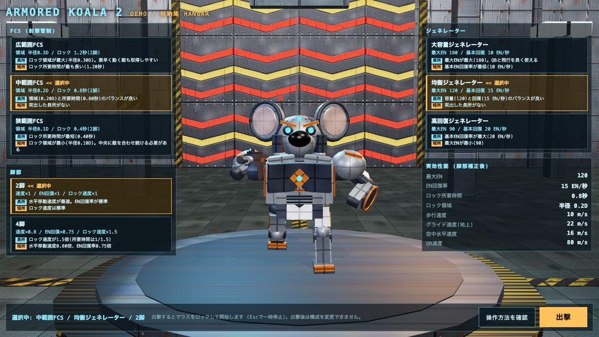
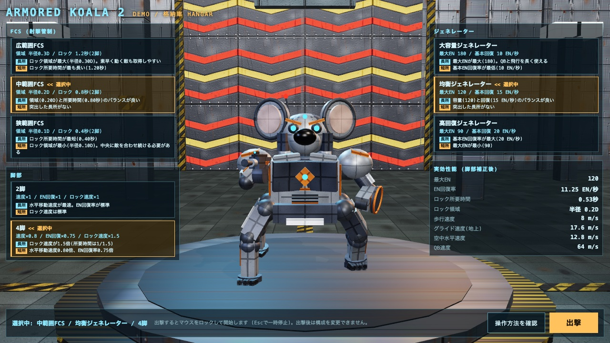
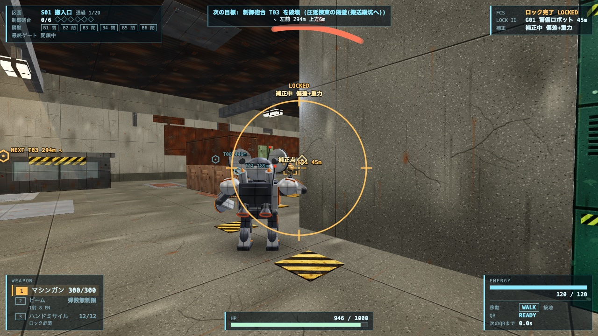
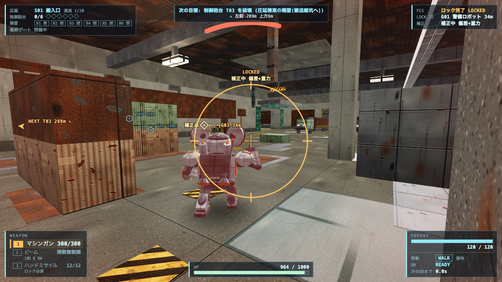
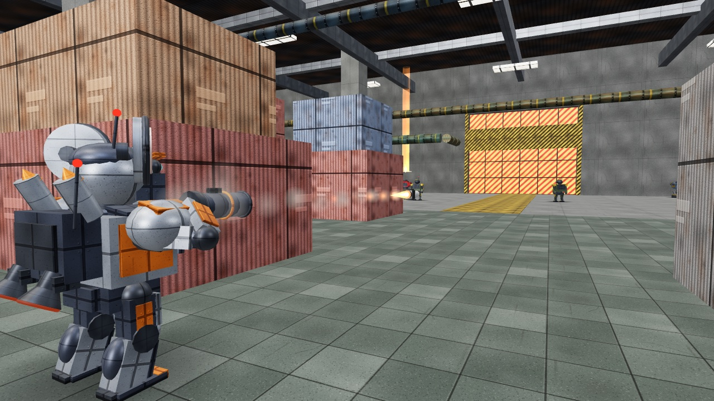
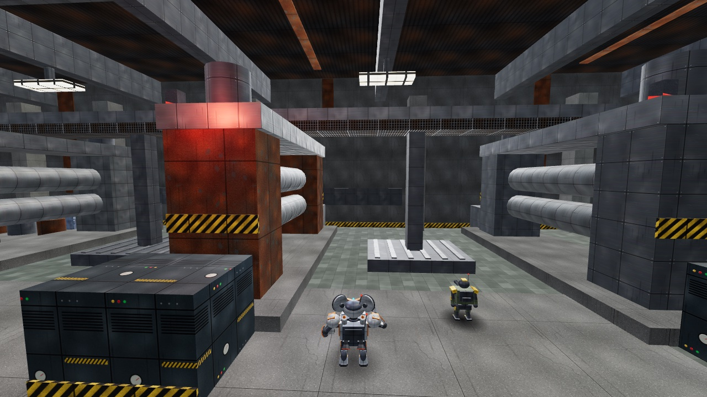

# ARMORED KOALA 2 (AK2) DEMO

コアラの頭を持つ戦闘ロボット「ARMORED KOALA」を操作し、敵の警備ロボットと固定砲台が守る廃工場から脱出する、TPS 視点の高速メカアクションシューティングです。
名称と設定はパロディーです。機体・敵・ステージ・効果は全てコード(プリミティブとコード生成のテクスチャ)で作っており、外部の画像・モデル・音源・フォント・CDN・API は使いません(音なし)。

- 技術: TypeScript / Three.js 0.186.0 / Vite 8.3.1 / Vitest 5.0.2(依存は全て固定バージョン、`package-lock.json` あり)
- 仕様書: [`docs/SPEC.md`](docs/SPEC.md)(原文)、設計と契約: [`docs/ARCH.md`](docs/ARCH.md)
- ゲームの中身: 3 種類の武器(マシンガン・ビーム・ハンドミサイル)と FCS の自動補正射撃、FCS 3 種 × ジェネレーター 3 種 × 脚部 2 種 = 18 通りの機体構成、
  クイックブースト(QB)・グライド・飛行と共通の EN、20 区画・敵 45 体の一続きの工場、制御砲台 6 体の破壊で開く隔壁 6 枚と最終ゲート、格納庫・プレイ中・一時停止・クリア・失敗・再出撃

## 目次

1. [概要とスクリーンショット](#1-概要とスクリーンショット)
2. [起動手順](#2-起動手順)
3. [操作方法とゲームの読み方](#3-操作方法とゲームの読み方)
4. [機体構成(18 通りの実効値)](#4-機体構成18-通りの実効値)
5. [アーキテクチャ](#5-アーキテクチャ)
6. [ステージ設計](#6-ステージ設計)
7. [検証(SPEC §4.6 / §11)](#7-検証spec-46--11)
8. [未確認項目・既知の問題・仕様の解釈判断](#8-未確認項目既知の問題仕様の解釈判断)
9. [開発ツールとテストの構成](#9-開発ツールとテストの構成)

## 1. 概要とスクリーンショット

画像は全て実ゲームの画面(headless の Chrome for Testing・ソフトウェア描画 SwiftShader で撮影。実 GPU の見た目・フレームレートは未確認)です。`docs/screens/` の画像を相対パスで参照しています。

| | |
| --- | --- |
| <br>格納庫(2脚)。左右のパネルで部品の長所・短所と、脚部補正後の実効値を確認できる | <br>格納庫(4脚)。脚部を変えると 3D モデルが 4 脚に変わる |
| <br>FCS のロック完了(マシンガン)。円は FCS の判定領域、四角の枠は対象の現在位置、ひし形は補正照準(実際の射出方向) | <br>交戦開始。左上に区画・制御砲台の破壊数・隔壁の状態、上に次の目標と方向、左のマーカーは次の制御砲台の方向 |
| <br>ハンドミサイル選択中(補正は偏差のみ) | <br>S03 圧延棟(戦闘区画。天井クレーン・加熱炉・圧延スタンド) |

## 2. 起動手順

```sh
npm ci                                             # 依存関係の導入(lockfile どおり)
npm run build                                      # 本番ビルド (vite build) -> dist/
npm run dev -- --host 0.0.0.0 --port 5173          # 開発サーバー (http://localhost:5173/)
npm run preview                                    # ビルド済みの dist/ を配信 (vite preview)
npm test                                           # 全テスト (vitest run)
npm run typecheck                                  # 型検査 (tsc --noEmit)
```

その他のスクリプト(`package.json` の `scripts`。詳細は [`tools/README.md`](tools/README.md))。

| スクリプト | 内容 |
| --- | --- |
| `npm run test:fast` | 長いテスト(下記 9 節の 8 ファイル)を除いた `vitest run`。19 ファイル・1114 テストで約 14〜18 秒(2026-09-30 実測) |
| `npm run stage:report` | ステージの検証器を実行して [`docs/STAGE.md`](docs/STAGE.md) を再生成(`tsx tools/stage-report.ts`) |
| `npm run playthrough` | 実際の `Game` を動かすボットによる通し走破(全 18 構成)。`-- --report docs/PLAYTHROUGH.md` で文書を更新 |
| `npm run perf` | 実ステージでの 1 tick の処理時間・メモリの計測。`-- --md docs/PLAYTHROUGH.md` で文書を更新 |
| `npm run e2e` | Playwright + Chrome for Testing で、ビルド済みゲームを実ブラウザ操作して総合検証(`docs/E2E.md` を更新) |

- **このコマンドの確認状況**(2026-09-30): `npm run build`・`npm test`・`npm run test:fast`・`npm run typecheck`・`npm run stage:report`・`npm run playthrough`・`npm run perf`・`npm run e2e` は、npm のスクリプト名で(または同じ `tsx tools/<名前>.ts` で)実行して成功を確認しました。
  `npm run dev -- --host 0.0.0.0` は、別のプロジェクトが使う可能性のある 5173・5174 を避け、`--port 5261` で起動して `/` と `/src/main.ts` が HTTP 200、全インターフェース(`*:5261`)で待ち受けることを確認しました(`vite.config.ts` が host 0.0.0.0・port 5173 を既定に持ち、引数はそのまま `vite` に渡ります)。`npm run preview` も `--port 5262` で HTTP 200 を確認しました。
  **`npm ci` は node_modules を作り直すため今回は実行していません**(【報告値】UI 監査担当が、`npm ci` 直後の複製で `npm ci`(53 パッケージ)・`npm run build`・`npm run dev -- --host 0.0.0.0 --port 5230` の成功を確認しています)。
- **対象ブラウザとデスクトップ環境**: デスクトップのキーボード・マウス操作、表示領域 1280×720 以上(ウィンドウのリサイズに追従)。動作確認は Chrome for Testing 149(Playwright 1.63、headless・ソフトウェア描画)だけです。Firefox / Safari / Edge・実 GPU・人間が実デスクトップで操作したときの確認はしていません(8 節)。
- **ポインターロック**: 格納庫の「出撃」ボタンを**クリック**すると、そのクリックでマウスのポインターロックを取得して出撃します(出撃・再開のクリックは射撃になりません)。**Esc** でポインターロックが解除され一時停止します。
  Esc・ポインターロックの喪失・ウィンドウのフォーカス喪失・タブの非表示のどれでも一時停止し、押していたキーは全て解除されます。一時停止画面の「再開」もクリックでポインターロックを取り直します。
  ポインターロックが取れなかったとき(ブラウザーの拒否・Esc 直後の再取得の制限など)は、説明と「再試行」ボタンを表示し、取得できるまでゲームは進みません(Esc で解除した直後は 1 秒ほど待つと再取得できます)。
- **URL クエリ `?seed=<32bit 符号なし整数>`**: ゲーム進行の乱数のシード(既定 `20260908`)。例: `http://localhost:5173/?seed=12345`。0〜4294967295 の 10 進整数だけを受け付け、それ以外(空・負数・小数・範囲外・16 進など)は既定値になります。出撃と再出撃で同じシードを使います。
- 外部通信はしません。ビルド成果物は `dist/index.html` + JS 1 本 + CSS 1 本です(2026-09-30 に `npm run build` を実行: JS 967.58 kB・gzip 277.45 kB)。

## 3. 操作方法とゲームの読み方

### 3.1 操作(SPEC §7.1)

| 操作 | 入力 | 2 脚での基準挙動 | EN 消費 |
| --- | --- | --- | --- |
| 通常移動 | WASD | 10 m/s(カメラの水平方向が基準。斜めで速くならない) | 0 |
| 視点・照準 | マウス移動 | TPS カメラの旋回 | 0 |
| ジャンプ | 接地中に Space を押す | 上向き初速 10 m/s | 0 |
| グライドの切り替え | Shift を 1 回押す | 地上 22 m/s。押し続ける必要はない | 0 |
| ブレーキ | 左 Ctrl を押す | グライド解除と慣性を伴う減速 | 0 |
| 飛行 | Space を 0.20 秒以上長押し | 空中水平移動 16 m/s、上昇速度 8 m/s | 20 EN/秒 |
| クイックブースト(QB) | Q を 1 回押す | 初速 80 m/s、噴射 0.15 秒、その後自動グライド | 発動時に 36 EN を 1 回だけ |
| 射撃 | マウス左ボタン | 押している間、武器の射撃間隔で発射 | 武器による |
| 武器切り替え | 1 / 2 / 3 | マシンガン / ビーム / ハンドミサイル | 0 |
| 一時停止 | Esc | ポインターロック解除と一時停止 | 0 |

4 脚は水平の移動速度(通常・グライド・空中・QB)が 0.80 倍です(ジャンプ初速・飛行の上昇速度・重力は変わりません)。

### 3.2 FCS(射撃管制)と照準

- **補正は自動です。対象を画面中央の FCS の円の中に保つだけで、偏差(対象の移動)と重力を自動で補正して撃ちます。中央の照準を補正照準マーカーへ手動で合わせる必要はありません**(対象の現在位置が円の中にある限り、補正点が円の外へ出てもロックは続きます)。
- ロックは自動で進みます。円の中に、生存中・銃口から 120 m 以内・カメラの前方・カメラと銃口の両方から遮蔽物がない対象があると、円の中心に最も近い 1 体を選んで進行(取得中)し、所定の時間で完了します。円の半径は表示領域の短い方 D に対して 広範囲 0.30D / 中範囲 0.20D / 狭範囲 0.10D、ロック所要時間は 2 脚で 1.20 / 0.80 / 0.40 秒です(4 脚はロック速度 1.5 倍で所要時間が 1/1.5)。
  対象が円の外へ出る・遮蔽される・破壊される・120 m を超えると、進捗ごと即座に破棄されます。武器を切り替えてもロックは維持されます。
- **マシンガン**(300 発、1 発 12 ダメージ、0.10 秒間隔、EN 0、初速 100 m/s・重力 18 m/s²): 未ロックでもカメラ中央へ自由射撃できます。ロック完了中は、射撃のたびに対象の現在位置と実際の速度から偏差と重力落下を同時に解いた方向へ銃口から発射します(発射後は放物線を描くだけで誘導はしません)。
- **ビーム**(弾数無制限、40 ダメージ、0.25 秒間隔、1 射 8 EN、射程 120 m): 即時命中。ロック完了中は対象の現在位置へ向けて撃ちます。
- **ハンドミサイル**(12 発、180 ダメージ、1.00 秒間隔、速度 45 m/s、旋回 120 度/秒、寿命 4 秒): **ロック完了時だけ**発射できます(未ロックでは弾も数も消費せず「NO LOCK」を表示)。偏差方向へ発射し、発射後は旋回上限つきで誘導します。
- 自機の速度は弾に加算されません(グライド・飛行・QB 中でも最新の銃口位置から撃ちます)。銃口の前の壁は貫通しません(機体中心から銃口までの間の壁も、その壁が最初の衝突として扱われます)。

### 3.3 QB・グライド・飛行と EN

- **QB は単発・36 EN**です。Q を押した瞬間にだけ判定し、キーリピートや押しっぱなしでは再発動しません(5 秒押し続けても成功は最大 1 回)。EN が 36 未満、前の QB から 1.00 秒未満、左 Ctrl を押している間は不成立で、EN も使わず予約もしません。
  WASD の方向(入力がなければカメラの前方)へ水平速度を 80 m/s(4 脚は 64 m/s)に設定し、0.15 秒噴射します。**Q や他のキーを離しても噴射は中断されず、噴射の後は自動でグライドへ移行し、速度を保ったまま滑らかに減速します**(地上では 0.60 秒で 22 m/s へ)。QB 後に入力がなくても、その方向へ動き続けます。
  空中でも使え、噴射後は空中の定常速度 16 m/s へ減速します。壁に当たると壁向きの速度が消えます。
- **グライドは 0 EN**です。Shift を 1 回押すと ON になり、入力方向(なければカメラの前方)へ加速して、キーを離してもその方向へ進み続けます。**止めるには左 Ctrl(ブレーキ)か、もう一度 Shift で解除**します(WASD を離しただけでは止まりません)。EN が 0 でも使え、接地中は EN 回復も妨げません。
- **飛行**: Space を 0.20 秒以上長押しすると、水平 16 m/s・上昇 8 m/s で 20 EN/秒を使って飛びます。Space を離すか EN が尽きると、現在の垂直速度を引き継いで重力(18 m/s²)で落下します。カメラを上に向けても WASD だけでは浮上しません。
- **EN の回復**は、接地中で、最後の実際の EN 消費から 0.75 秒以上経っているときだけです(歩行・地上グライド・ロック・マシンガン・ミサイルは回復を妨げません。QB・飛行・ビームが EN を使います。空中では回復しません)。回復率はジェネレーターの基本回復率 × 脚部倍率です。
  例: 地上で時刻 0 に QB を 1 回使い、他に EN を使わなければ、0.75 秒後からグライドしながら回復します。HP の自然回復と、弾薬・EN の補給アイテムはありません。

### 3.4 HUD の読み方

| 場所 | 表示 |
| --- | --- |
| 中央 | FCS の判定円(半径 = 実際の判定円。リサイズしても一致)。未取得は細い円、**取得中は点線の円 + 進捗リング + 「LOCKING nn%」**、**ロック完了は実線の円 + 四隅の目盛り + 「LOCKED」**。対象マーカー(四角の枠 + ID・距離)と、補正照準マーカー(ひし形 + 「補正点」)は別の形。「補正中 偏差+重力」(マシンガン)/「補正中 現在位置」(ビーム)/「補正中 偏差」(ミサイル)、有効な解がなければ「補正解なし」(×印で現在位置へ直接照準。ロックは維持)。マーカーが画面外なら端の矢印 |
| 左下 | WEAPON: 1/2/3、残弾(ビームは「弾数無制限」「1射 8 EN」、ミサイルは「ロック必須」)。弾切れは「弾切れ」 |
| 下 | HP(現在値/最大値とバー) |
| 右下 | ENERGY(現在値/最大値とバー)、移動モード(WALK / GLIDE / QB)と垂直状態(接地・上昇・飛行・落下)、QB の状態(READY / COOLDOWN n.n s / EN不足 / BRAKE Ctrl解除)と次の QB までの秒数 |
| 左上 | 現在の区画と通過数(n/20)、制御砲台の破壊数(0/6〜6/6)、隔壁 B1〜B6 の開閉、最終ゲート(「最終ゲート 閉鎖中」/「最終ゲート開放 - 脱出可能」)。隔壁が開くと「隔壁 Bn 開放: (方向の説明)」を数秒表示 |
| 上 | 次の目標(次に破壊する制御砲台とその隔壁、方向・距離・高さ。6 体破壊後は「最終ゲートから脱出領域へ」)。画面内外の「NEXT Txx」マーカーは次の制御砲台の方向 |
| 右上 | FCS の状態(ロック完了/取得中)、LOCK ID(対象と距離)、補正の状態 |
| その他 | 敵の射撃予告(砲口の光と予告マーカー。警備 0.15 秒・砲台 0.35 秒前)、被弾方向のウェッジ、通知(NO LOCK / EN不足 / 弾切れ / 補正解なし)。クリア・失敗では結果画面(理由・経過時間・撃破数・制御砲台数・被ダメージ・通過区画数)と「同じ構成で再出撃」「格納庫へ戻る」 |

操作説明は出撃前(格納庫の「操作方法を確認」)と一時停止画面の両方から開けます。

### 3.5 ゲームの目的

制御砲台 6 体(T03・T07・T08・T11・T14・T15)を順に破壊すると、対応する隔壁が開いて先の区画へ進めます。6 体すべてを破壊すると最終ゲートが開き、生存したまま脱出領域に入るとクリアです。残る 39 体の全滅は必要ありません。
HP が 0 以下になるか、復帰できないステージ外へ落下すると失敗です。制御砲台の遠隔破壊、迂回路(分岐)の選択、遮蔽物の利用が攻略の軸です。

## 4. 機体構成(18 通りの実効値)

FCS 3 種 × ジェネレーター 3 種 × 脚部 2 種の 18 通りは全て使えます(初期選択は 中範囲 FCS・均衡ジェネレーター・2 脚・マシンガン)。出撃後は変更できません。
下表は `src/sim/stats.ts` の `computeEffectiveStats` と `src/config.ts` から**スクリプトで生成**した値です(2026-09-30。最大 EN × 基本回復率 = 1800 で、最大 EN と基本回復率は反比例)。
ロック所要時間 = FCS の基本所要時間 ÷ 脚部のロック速度倍率(4 脚は ÷1.5。×1.5 ではない)、EN 回復率 = 基本回復率 × 脚部の回復率倍率(4 脚 0.75)。速度は「歩行 / 地上グライド / 空中 / QB 初速」です。

| FCS | ジェネレーター | 脚部 | 最大EN | EN回復率 [EN/秒] | ロック所要時間 [秒] | ロック半径 | 歩行 / グライド(地上) / 空中 / QB初速 [m/s] |
| --- | --- | --- | ---: | ---: | ---: | --- | --- |
| 広範囲 | 大容量 | 2脚 | 180 | 10 | 1.2 | 0.3D (216 px @1280x720) | 10 / 22 / 16 / 80 |
| 広範囲 | 大容量 | 4脚 | 180 | 7.5 | 0.8 | 0.3D (216 px @1280x720) | 8 / 17.6 / 12.8 / 64 |
| 広範囲 | 均衡 | 2脚 | 120 | 15 | 1.2 | 0.3D (216 px @1280x720) | 10 / 22 / 16 / 80 |
| 広範囲 | 均衡 | 4脚 | 120 | 11.25 | 0.8 | 0.3D (216 px @1280x720) | 8 / 17.6 / 12.8 / 64 |
| 広範囲 | 高回復 | 2脚 | 90 | 20 | 1.2 | 0.3D (216 px @1280x720) | 10 / 22 / 16 / 80 |
| 広範囲 | 高回復 | 4脚 | 90 | 15 | 0.8 | 0.3D (216 px @1280x720) | 8 / 17.6 / 12.8 / 64 |
| 中範囲 | 大容量 | 2脚 | 180 | 10 | 0.8 | 0.2D (144 px @1280x720) | 10 / 22 / 16 / 80 |
| 中範囲 | 大容量 | 4脚 | 180 | 7.5 | 0.533 | 0.2D (144 px @1280x720) | 8 / 17.6 / 12.8 / 64 |
| 中範囲 | 均衡 | 2脚 | 120 | 15 | 0.8 | 0.2D (144 px @1280x720) | 10 / 22 / 16 / 80 |
| 中範囲 | 均衡 | 4脚 | 120 | 11.25 | 0.533 | 0.2D (144 px @1280x720) | 8 / 17.6 / 12.8 / 64 |
| 中範囲 | 高回復 | 2脚 | 90 | 20 | 0.8 | 0.2D (144 px @1280x720) | 10 / 22 / 16 / 80 |
| 中範囲 | 高回復 | 4脚 | 90 | 15 | 0.533 | 0.2D (144 px @1280x720) | 8 / 17.6 / 12.8 / 64 |
| 狭範囲 | 大容量 | 2脚 | 180 | 10 | 0.4 | 0.1D (72 px @1280x720) | 10 / 22 / 16 / 80 |
| 狭範囲 | 大容量 | 4脚 | 180 | 7.5 | 0.267 | 0.1D (72 px @1280x720) | 8 / 17.6 / 12.8 / 64 |
| 狭範囲 | 均衡 | 2脚 | 120 | 15 | 0.4 | 0.1D (72 px @1280x720) | 10 / 22 / 16 / 80 |
| 狭範囲 | 均衡 | 4脚 | 120 | 11.25 | 0.267 | 0.1D (72 px @1280x720) | 8 / 17.6 / 12.8 / 64 |
| 狭範囲 | 高回復 | 2脚 | 90 | 20 | 0.4 | 0.1D (72 px @1280x720) | 10 / 22 / 16 / 80 |
| 狭範囲 | 高回復 | 4脚 | 90 | 15 | 0.267 | 0.1D (72 px @1280x720) | 8 / 17.6 / 12.8 / 64 |

再生成コマンド:

```sh
npx tsx -e "import { FCS_PARTS as F, GENERATOR_PARTS as G, LEGS_PARTS as L } from './src/config'; import { computeEffectiveStats as c } from './src/sim/stats'; for (const f of Object.keys(F)) for (const g of Object.keys(G)) for (const l of Object.keys(L)) { const s = c({ fcs: f, generator: g, legs: l } as any); console.log(f, g, l, s.maxEn, s.regenPerSecond, s.lockSeconds.toFixed(3), s.horizontalSpeedMultiplier); }"
```

例(SPEC §6): 中範囲 FCS・均衡・4 脚は、最大 EN 120、回復率 11.25 EN/秒、ロック所要時間 約 0.533 秒(表の 10 行目)。最小の最大 EN は 90、最も遅い空中水平速度は 12.8 m/s(4 脚)です。

## 5. アーキテクチャ

### 5.1 ファイル構成

```
index.html, src/main.ts        起動。window.AK2_BENCH = { getSnapshot } だけを公開する
viewer.html                    開発用の描画ビューア (本番ビルドには含まれない。src/render/viewer*.ts)
src/config.ts                  全ゲームパラメーター(単一の真実。仕様の数値は全てここ)
src/sim/   シミュレーション (DOM / Three.js に依存しない純粋な TypeScript。Node でそのまま動く)
  game.ts        Game: 固定 tick(1/120 秒)の順序と状態遷移 (garage / playing / paused / cleared / failed)
  types.ts       共有型 (GameState 他)        math.ts / rng.ts     ベクトル・yaw 規約 / シード付き乱数
  world.ts       AABB の衝突ワールド (BVH。raycast / sweepSphere / sweepAABB / 線分遮蔽)
  player.ts      移動・EN・QB・グライド・飛行     camera.ts   TPS カメラ・銃口位置・照準点
  ballistics.ts  偏差・重力ソルバー (純関数)      fcs.ts      ロックと射撃解 (HUD・実射撃・snapshot が共有)
  weapons.ts / projectiles.ts   3 武器の射撃、プレイヤーの弾体 (マシンガン・ミサイル) の掃引衝突
  enemies.ts / nav.ts           敵の生成・AI・敵弾 / 警備ロボットの経路探索 (2 m 格子の A*)
  objective.ts   区画追跡・隔壁・最終ゲート・クリア/失敗    bench.ts   getSnapshot (SPEC §10。状態のコピー)
  stats.ts / project.ts / combat.ts   実効ステータス / 画面投影 (FCS と HUD が共有) / ダメージとイベント
  scenario.ts / testArena.ts    SPEC §4.6 の分離試験用の配置 / 障害物なしの試験アリーナ (本番の AI・武器・当たり判定をそのまま使う)
src/stage/   ステージ定義
  blueprint.ts   区画・portal・隔壁・昇降・敵の予算などの骨格データ      routes.ts   主経路・分岐の折れ線 (tools/route-probe.ts が生成)
  kit.ts         区画ビルダー (殻の自動生成・箱・敵のプリミティブ・見た目=衝突箱)     index.ts   buildStage()
  sectors/S01.ts … S20.ts   各区画の内部        validate.ts   ステージ検証器 (実際の World と Game の物理で計測)
src/render/  Three.js の描画 (GameState を読むだけで、シミュレーションを変更しない)
  renderer.ts (GameRenderer) / hangar.ts / mech.ts / enemyModels.ts / stageMesh.ts (区画・材質ごとの結合メッシュ) / visibility.ts (portal による区画の可視判定)
  effects.ts (寿命つきの固定プールの効果) / textures.ts (コード生成のテクスチャ) / atmosphere.ts / look.ts / aim.ts (腕・銃口の向き=実際の射出方向) / cameraRig.ts / geo.ts / parts.ts
src/ui/      HUD (DOM + SVG)・格納庫・一時停止/結果の画面・入力・ポインターロック
  app.ts (状態遷移とループ) / hud.ts + hudLogic.ts / garage.ts + garageLogic.ts / screens.ts / controlsHelp.ts / input.ts / seed.ts / style.css
tests/       vitest (9 節)          tools/    検証ツール (tsx。9 節、tools/README.md)          docs/    仕様・設計・検証結果
```

### 5.2 シミュレーションとレンダラーの分離

- `src/sim/**` は DOM と Three.js を import しません。本番と同じ `Game` クラスを Node(vitest)で tick 実行して検証しています(7 節の命中試験・QB 試験・敵 AI 試験・通し走破は全てこの `Game` を使い、試験専用の照準・弾道・命中処理は持ちません)。
- 描画(`src/render/**`)と UI(`src/ui/**`)は `GameState` を読むだけです。HUD のマーカーは FCS と同じ投影 `projectToScreen` を使い、腕・銃口の向きは実際の射出方向(`state.fc.launchDirection` または自由射撃方向)に一致させています。
- 入力は `Game.input`(安定したオブジェクト)にレベルで書き、エッジ検出(QB・ジャンプ・グライド切替)は sim 側で行います。Q・Shift・Space の keydown の `event.repeat` は無視します。keydown と keyup が次の tick より前に来ても押下を失わないよう、押下を最低 1 tick は sim に見せてから解放します。

### 5.3 tick の順序(`Game.step()`、1 tick = 1/120 秒)

```
A. 時刻 T の判断・発射 (状態は全て T の値)
   武器切替 -> playerBeginTick (QB 発動: 36 EN・グライド切替・ジャンプ) -> playerFireStep (ロック再検証 -> 同時刻の値で射撃解 -> 弾/ビーム。ビームの EN 8 はここで支払う)
   -> enemyDecisionStep (射線・記憶・共有・偏差射撃・敵弾の生成)
B. T -> T+dt の積分
   playerIntegrate (飛行 EN は QB・ビームの残りから。移動・衝突・重力・EN 回復) -> enemyIntegrate -> 弾体の掃引衝突 (プレイヤーの弾・敵弾。生成した弾も同じ tick で dt だけ進む)
C. T+dt の後処理
   tick++ / time = tick*dt -> updateCamera -> updateFcs (ロックの検証・進捗・HUD 用の射撃解) -> updateProgress (区画・隔壁・ゲート・クリア/失敗)
```

EN の判定順は QB(36)→ ビーム(8)→ 飛行(20/秒)で、費用を払えない動作だけが不成立になります。フレームレート(描画)から独立で、描画が 30・60・120 fps でも同じ tick 列を実行します(`Game.advance` は経過時間から固定 tick を回し、1 フレームの上限は 0.25 秒)。一時停止中は何も進みません。

### 5.4 決定性とシード

ゲーム進行の乱数は出撃ごとに初期化するシード付き乱数(`src/sim/rng.ts` の mulberry32)だけです(敵の照準のばらつき(最大 0.5 度)と警備ロボットの側方移動の向きに使用。プレイヤーの武器・移動は乱数を使いません)。
シードは URL の `?seed=`(既定 20260908)で、再出撃でも同じシードを使います。同じ実装・シード・構成・入力なら、フレーム分割が違っても進行が再現します(7.9 節の E2E 7.8)。視覚効果だけの乱数はゲーム進行の乱数系列と分離しています。`src/sim` は `Math.random()` / `Date.now()` を使いません。

### 5.5 `window.AK2_BENCH` と座標規約

- `window.AK2_BENCH` は `getSnapshot()` だけを持つ凍結オブジェクトです(SPEC §10 の構造の**コピー**を返し、呼び出してもゲーム状態は変わりません。他のメソッドはありません)。
- 単位は m・秒・rad(内部)、Y が上、ステージは x 東 / z 南 / y 上。yaw は Three.js の `camera.rotation.y` と同じで、yaw=0 は -Z を向き、マウスを右へ動かすと yaw が減ります。
- **プレイヤーと敵の `position` は当たり判定の中心**です(プレイヤーは 1.6 × 3.0 × 1.6 m の AABB の中心 = 足元 + 1.5 m、敵は球の中心)。敵とプレイヤーは互いに衝突しません。
- ステージは全て AABB の箱で、描画メッシュ = 衝突箱です(装飾 `StageDef.decor` だけが衝突なしで、通行可能空間には入りません)。

## 6. ステージ設計

SPEC §2.2 が求める「区画 ID・境界、接続関係、隔壁、制御砲台、敵の初期配置、攻略経路の座標」の記録です。定義本体は [`src/stage/blueprint.ts`](src/stage/blueprint.ts)(骨格)・[`src/stage/routes.ts`](src/stage/routes.ts)(経路)・[`src/stage/sectors/`](src/stage/sectors)(各区画の内部と敵の配置)、
検証器が実際の衝突形状と実際のプレイヤー物理で計測した結果は [`docs/STAGE.md`](docs/STAGE.md)(`npm run stage:report` で再生成。今回再生成済み)、骨格の設計意図は [`docs/STAGE_BLUEPRINT.md`](docs/STAGE_BLUEPRINT.md) にあります。以下は `buildStage()` から生成した要約です。

### 6.1 規模と検証器の実測(2026-09-30 に `npm run stage:report` を実行。必須 32 項目すべて合格)

| SPEC §2.2 の項目 | 必須条件 | 実測(検証器) |
| --- | --- | --- |
| 区画数 | 15 以上 | 20(区画 bounds の重なり 0、空間種別 9 種、名称 20 種) |
| 必須経路で物理的に通る区画 | 12 以上 | 16(S01 → S16。区画グラフの最少ホップも 16 で、区画を飛ばす近道はない) |
| 最短の実行可能経路 | 1500 m 以上 | **2149.3 m**(平滑化 + `sweepAABB` 検証済みの上界。格子 A* の生の長さ 2310.9 m、直線 727.5 m)。`mainRoute` の記載長は 2231.2 m |
| 分岐(別の場所で再合流) | 3 か所以上 | 4(BR1〜BR4) |
| 環状経路 | 2 か所以上 | 4(LOOP-BR1〜BR4) |
| 飛行が必要な昇降 | 6 か所以上(6〜16 m) | 8(C1〜C8。12 m × 7 + 14 m)。通常ジャンプの最大上昇 2.79 m では届かず、全 18 構成のボットが実際の物理で 144/144 成功。EN 消費は最大 33.0(最小の最大 EN は 90) |
| 階層 | 3 層以上 | 4 層(地下 -14 / 地上 0 / 中層 +12 / 上層 +24。立てる大きな床面の高度帯は 15) |
| 広い戦闘区画(60 × 50 m 以上) | 5 か所以上 | 9(S02 S03 S05 S08 S09 S11 S12 S13 S14) |
| 複数方向の攻撃(4 体以上が射線) | 別々の 5 区画 | 6(S02 5/6・S03 5/5・S05 6/6・S08 5/5・S12 5/6・S13 4/4) |
| 空間構成の違い | 6 種類以上 | 9(搬入口・広場・製造室・縦坑・上下層・配管・搬送路/トンネル・倉庫・ゲート) |
| 敵 | 警備 30 + 砲台 15 = 45 | 30 + 15 = 45(HP 120 / 240)。制御砲台 6 体は 6 つの別区画で隔壁と 1 対 1。全て床・台座の上で、埋まり・浮き・頭上空き不足は 0 |
| 外周・屋根 | 飛行で壁を越えて省略できない | 到達可能な自由空間が区画 bounds の外に出る箇所 0、屋根の開口 0、宣言のない開口 0。隔壁を 1 つだけ閉じても、全て閉じても、脱出領域に着けない |
| 開始地点の安全 | 出撃直後に被弾しない | 45 体の全銃口からプレイヤー箱の 27 点への射線が通らない |

区画・portal・隔壁・昇降の数値は次のとおりです。座標は m(x 東 / y 上 / z 南)、位置は当たり判定の中心です。

### 6.2 区画表(ID・名称・種別・階層・bounds・敵数)

階層は区画の主な床の高さで、S06・S08・S12 は 1 つの区画に複数の高さの床(ギャラリー・吹き抜け)を持ちます。

| ID | 名称 | 種別 | 階層 (床Y) | bounds min (x, y, z) | bounds max (x, y, z) | 戦闘区画 | 警備 | 砲台 | 計 |
| --- | --- | --- | --- | --- | --- | --- | ---: | ---: | ---: |
| S01 | 搬入口 | dock | 地上 0 | (0, -2, 0) | (70, 16, 140) | - | 2 | 0 | 2 |
| S02 | 資材ヤード | yard | 地上 0 | (70, -2, 0) | (200, 26, 140) | ○ | 4 | 2 | 6 |
| S03 | 圧延棟 | factory | 地上 0 | (200, -2, 0) | (330, 28, 140) | ○ | 3 | 2 | 5 |
| S04 | 搬送縦坑 | shaft | 地上 0 | (330, -2, 60) | (390, 28, 140) | - | 0 | 0 | 0 |
| S05 | 組立ライン | factory | 中層 +12 | (390, 10, 0) | (530, 36, 140) | ○ | 4 | 2 | 6 |
| S06 | 検査棟 | multilevel | 中層 +12 | (530, 10, 0) | (640, 42, 140) | - | 2 | 1 | 3 |
| S07 | 保守用配管区画 | pipe | 上層 +24 | (530, 22, 140) | (640, 42, 280) | - | 1 | 0 | 1 |
| S08 | 動力棟 | multilevel | 地上 0 | (390, -2, 140) | (530, 42, 280) | ○ | 3 | 2 | 5 |
| S09 | 冷却設備 | factory | 地上 0 | (270, -2, 140) | (390, 32, 280) | ○ | 2 | 1 | 3 |
| S10 | 排気縦坑 | shaft | 地下 -14 | (210, -16, 200) | (270, 28, 280) | - | 0 | 0 | 0 |
| S11 | 地下搬送区画 | corridor | 地下 -14 | (80, -16, 140) | (210, 14, 280) | ○ | 2 | 1 | 3 |
| S12 | 主製造ホール | multilevel | 地上 0 | (0, -2, 280) | (220, 44, 430) | ○ | 4 | 2 | 6 |
| S13 | 出荷倉庫 | warehouse | 地上 0 | (220, -2, 340) | (350, 42, 490) | ○ | 3 | 1 | 4 |
| S14 | 外周搬送路 | corridor | 地上 0 | (350, -2, 340) | (500, 32, 490) | ○ | 0 | 1 | 1 |
| S15 | 搬出ゲート | gate | 中層 +12 | (500, 10, 340) | (640, 42, 490) | - | 0 | 0 | 0 |
| S16 | 脱出領域 | yard | 上層 +24 | (640, 22, 340) | (720, 42, 490) | - | 0 | 0 | 0 |
| S17 | 旧搬送トンネル | corridor | 地上 0 | (100, -2, -40) | (300, 14, 0) | - | 0 | 0 | 0 |
| S18 | 屋根裏保守通路 | corridor | 中層 +12 | (390, 10, -50) | (640, 26, 0) | - | 0 | 0 | 0 |
| S19 | 上層配管ダクト | pipe | 上層 +24 | (400, 22, 280) | (640, 38, 340) | - | 0 | 0 | 0 |
| S20 | 旧倉庫 | warehouse | 上層 +24 | (120, 22, 430) | (220, 38, 510) | - | 0 | 0 | 0 |

合計: 警備 30 + 砲台 15 = 45

### 6.3 接続(portal)

portal は全て 14 × 8 m(要件は幅 5 m・高さ 6 m 以上)。開口は両側の区画で同じ位置・寸法に空いています。

| ID | 接続 (a → b) | 中心 (x, y, z) | 幅 × 高 [m] | 種別 | 隔壁 |
| --- | --- | --- | --- | --- | --- |
| P01 | S01 → S02 | (70.0, 4.0, 120.0) | 14 × 8 | door | - |
| P02 | S02 → S03 | (200.0, 4.0, 20.0) | 14 × 8 | door | - |
| P03 | S03 → S04 | (330.0, 4.0, 100.0) | 14 × 8 | door | B1 |
| P04 | S04 → S05 | (390.0, 16.0, 100.0) | 14 × 8 | shaft | - |
| P05 | S05 → S06 | (530.0, 16.0, 20.0) | 14 × 8 | door | - |
| P06 | S06 → S07 | (620.0, 28.0, 140.0) | 14 × 8 | catwalk | B2 |
| P07 | S07 → S08 | (530.0, 28.0, 266.0) | 14 × 8 | catwalk | - |
| P08 | S08 → S09 | (390.0, 4.0, 156.0) | 14 × 8 | door | B3 |
| P09 | S09 → S10 | (270.0, 16.0, 266.0) | 14 × 8 | catwalk | - |
| P10 | S10 → S11 | (210.0, -10.0, 214.0) | 14 × 8 | tunnel | - |
| P11 | S11 → S12 | (92.0, 4.0, 280.0) | 14 × 8 | catwalk | B4 |
| P12 | S12 → S13 | (220.0, 28.0, 354.0) | 14 × 8 | catwalk | - |
| P13 | S13 → S14 | (350.0, 4.0, 352.0) | 14 × 8 | door | B5 |
| P14 | S14 → S15 | (500.0, 16.0, 474.0) | 14 × 8 | catwalk | B6 |
| P15 | S15 → S16 | (640.0, 28.0, 352.0) | 14 × 8 | door | GATE |
| P16 | S02 → S17 | (120.0, 4.0, 0.0) | 14 × 8 | tunnel | - |
| P17 | S17 → S03 | (280.0, 4.0, 0.0) | 14 × 8 | tunnel | - |
| P18 | S05 → S18 | (410.0, 16.0, 0.0) | 14 × 8 | tunnel | - |
| P19 | S18 → S06 | (620.0, 16.0, 0.0) | 14 × 8 | tunnel | - |
| P20 | S07 → S19 | (600.0, 28.0, 280.0) | 14 × 8 | tunnel | - |
| P21 | S19 → S08 | (420.0, 28.0, 280.0) | 14 × 8 | catwalk | - |
| P22 | S12 → S20 | (200.0, 28.0, 430.0) | 14 × 8 | catwalk | - |
| P23 | S20 → S13 | (220.0, 28.0, 470.0) | 14 × 8 | catwalk | - |

### 6.4 隔壁と制御砲台

制御砲台の破壊で対応する隔壁の箱が world から外れて通れるようになります。隔壁は全て区画グラフの切断点にあり、迂回できません(1 つだけ閉じると脱出領域に着けない)。6 体すべての破壊で最終ゲートが開きます。

| 隔壁 | 表示ラベル | 塞ぐ portal | 制御砲台 | 砲台の区画 | 砲台位置 | 隔壁位置 |
| --- | --- | --- | --- | --- | --- | --- |
| B1 | 圧延棟東の隔壁(搬送縦坑へ) | P03 (S03 → S04) | T03 | S03 | (322.0, 7.6, 12.0) | (330.0, 4.0, 100.0) |
| B2 | 検査棟南の隔壁(配管区画へ) | P06 (S06 → S07) | T07 | S06 | (632.0, 21.6, 30.0) | (620.0, 28.0, 140.0) |
| B3 | 動力棟西の隔壁(冷却設備へ) | P08 (S08 → S09) | T08 | S08 | (440.0, 7.6, 240.0) | (390.0, 4.0, 156.0) |
| B4 | 地下搬送区画南の隔壁(主製造ホールへ) | P11 (S11 → S12) | T11 | S11 | (196.0, -4.4, 146.0) | (92.0, 4.0, 280.0) |
| B5 | 出荷倉庫東の隔壁(外周搬送路へ) | P13 (S13 → S14) | T14 | S13 | (338.0, 7.6, 420.0) | (350.0, 4.0, 352.0) |
| B6 | 外周搬送路東の隔壁(搬出ゲートへ) | P14 (S14 → S15) | T15 | S14 | (470.0, 9.6, 350.0) | (500.0, 16.0, 474.0) |
| GATE | 最終搬出ゲート | P15 (S15 → S16) | (制御砲台6体すべての破壊) | - | - | (640.0, 28.0, 352.0) |

### 6.5 分岐 4・環状経路 4・飛行昇降 8

分岐は、短いが広い戦闘区画を横切って多方向から狙われる経路(direct)と、長いが低い天井・柱・棚・配管で遮蔽が使える迂回路(tunnel / attic / duct / warehouse)の組です(長さは折れ線の長さ。実測は [`docs/STAGE.md`](docs/STAGE.md) §7)。

| 分岐 | 分岐区画 → 合流区画 | 経路 | 長さ [m] | 通る区画 |
| --- | --- | --- | ---: | --- |
| BR1 | S02 → S03 | BR1-direct | 240.65 | S02 > S03 |
| BR1 | S02 → S03 | BR1-tunnel | 351.16 | S02 > S17 > S03 |
| BR2 | S05 → S06 | BR2-direct | 209.12 | S05 > S06 |
| BR2 | S05 → S06 | BR2-attic | 392.47 | S05 > S18 > S06 |
| BR3 | S07 → S08 | BR3-direct | 208.58 | S07 > S08 |
| BR3 | S07 → S08 | BR3-duct | 408.05 | S07 > S19 > S08 |
| BR4 | S12 → S13 | BR4-direct | 65.04 | S12 > S13 |
| BR4 | S12 → S13 | BR4-warehouse | 200.76 | S12 > S20 > S13 |

環状経路(分岐と同じ構造。出発点へ同じ通路の単純な往復以外で戻れる局所的な経路):

| ID | 折れ線の長さ [m] | 通る区画 |
| --- | ---: | --- |
| LOOP-BR1 | 591.8 | S02 > S03 > S17 |
| LOOP-BR2 | 601.6 | S05 > S06 > S18 |
| LOOP-BR3 | 616.6 | S07 > S08 > S19 |
| LOOP-BR4 | 265.8 | S12 > S13 > S20 |

飛行昇降(下の足場から上の足場へ、Space 長押しの飛行 + 水平移動 + 解放で着地。上の足場は 28 × 34 m 以上で、昇降の前後には接地して EN を回復できる床があります):

| ID | 区画 | 高低差 [m] | 下の足場 (離陸位置) | 上の足場 (着地位置) |
| --- | --- | ---: | --- | --- |
| C1 | S04 | 12 | (352.0, 0.0, 100.0) | (366.0, 12.0, 100.0) |
| C2 | S06 | 12 | (584.0, 12.0, 96.0) | (594.0, 24.0, 106.0) |
| C3 | S09 | 12 | (304.0, 0.0, 228.0) | (300.0, 12.0, 242.0) |
| C4 | S11 | 14 | (138.0, -14.0, 256.0) | (122.0, 0.0, 256.0) |
| C5 | S12 | 12 | (160.0, 0.0, 292.0) | (160.0, 12.0, 306.0) |
| C6 | S12 | 12 | (168.0, 12.0, 322.0) | (188.0, 24.0, 332.0) |
| C7 | S14 | 12 | (452.0, 0.0, 434.0) | (466.0, 12.0, 448.0) |
| C8 | S15 | 12 | (590.0, 12.0, 396.0) | (604.0, 24.0, 382.0) |

### 6.6 主経路の座標と長さ

`StageDef.mainRoute`(スタートから脱出領域まで、全隔壁開放・飛行可の折れ線。`tools/route-probe.ts --emit` が生成し、全隔壁を開けた実際の衝突で `sweepAABB` 検証済み)。プレイヤー中心の座標と累積長:

<details><summary>mainRoute の 45 点(累積 2231.2 m)</summary>

```
00  (12.0, 1.5, 14.0)  0.0 m
01  (20.0, 1.5, 52.0)  38.8 m
02  (34.0, 1.5, 54.0)  53.0 m
03  (56.0, 1.5, 88.0)  93.5 m
04  (66.0, 3.5, 114.0)  121.4 m
05  (78.0, 3.5, 114.0)  133.4 m
06  (196.0, 5.5, 26.0)  280.6 m
07  (258.0, 5.5, 26.0)  342.6 m
08  (326.0, 5.5, 94.0)  438.8 m
09  (354.0, 9.5, 94.0)  467.1 m
10  (358.0, 13.5, 94.0)  472.7 m
11  (458.0, 13.5, 94.0)  572.7 m
12  (526.0, 17.5, 26.0)  669.0 m
13  (534.0, 17.5, 26.0)  677.0 m
14  (588.0, 25.5, 110.0)  777.2 m
15  (614.0, 25.5, 136.0)  813.9 m
16  (614.0, 25.5, 174.0)  851.9 m
17  (568.0, 25.5, 214.0)  912.9 m
18  (534.0, 25.5, 260.0)  970.1 m
19  (492.0, 25.5, 260.0)  1012.1 m
20  (414.0, 25.5, 182.0)  1122.4 m
21  (394.0, 5.5, 162.0)  1157.0 m
22  (386.0, 5.5, 162.0)  1165.0 m
23  (300.0, 13.5, 234.0)  1277.5 m
24  (274.0, 13.5, 260.0)  1314.2 m
25  (266.0, 13.5, 260.0)  1322.2 m
26  (248.0, 13.5, 242.0)  1347.7 m
27  (238.0, 5.5, 234.0)  1362.8 m
28  (214.0, -8.5, 220.0)  1393.9 m
29  (154.0, -8.5, 220.0)  1453.9 m
30  (132.0, 1.5, 242.0)  1486.6 m
31  (98.0, 1.5, 276.0)  1534.7 m
32  (98.0, 1.5, 284.0)  1542.7 m
33  (166.0, 13.5, 298.0)  1613.1 m
34  (192.0, 25.5, 324.0)  1651.8 m
35  (216.0, 25.5, 348.0)  1685.8 m
36  (326.0, 25.5, 348.0)  1795.8 m
37  (348.0, 5.5, 358.0)  1827.1 m
38  (386.0, 5.5, 358.0)  1865.1 m
39  (466.0, 13.5, 438.0)  1978.5 m
40  (496.0, 13.5, 468.0)  2021.0 m
41  (526.0, 13.5, 468.0)  2051.0 m
42  (602.0, 25.5, 392.0)  2159.1 m
43  (636.0, 25.5, 358.0)  2207.2 m
44  (660.0, 25.5, 358.0)  2231.2 m
```

</details>

検証器が独立に求めた最短経路(47 点)は [`docs/STAGE.md`](docs/STAGE.md) §6.1 にあります。区画への進入位置(経路長): S01 0.0 / S02 121.5 / S03 279.5 / S04 426.5 / S05 487.5 / S06 644.0 / S07 792.0 / S08 943.0 / S09 1116.0 / S10 1277.0 / S11 1355.0 / S12 1486.5 / S13 1630.0 / S14 1762.5 / S15 1949.5 / S16 2129.5 m。

**経路長の違いの説明**: 「最短の実行可能経路」(検証器 2149.3 m、`mainRoute` の記載 2231.2 m、`tools/route-probe.ts` の平滑化 2235.0 m)は、飛行自由・EN 無視・全隔壁開放の 3D 最短経路の**上界**で、床の 2〜4 m 上を浮いて障害物を飛び越える区間が長く、そのまま歩くことはできません(最悪構成の飛行は 90 EN / 20 = 4.5 秒しか続かない)。
これに対し、通し走破ボット(`tools/playthrough.ts`)が実際に走った距離は、**歩行 + 落下(3 か所: S08 24 m・S10 縦坑 26 m・S13 24 m)+ 飛行昇降 8 回**で **2359〜2374 m**(最悪構成 2374 m、最良構成 2359 m。検証器の値の 1.10 倍、`mainRoute` の 1.06 倍)です(7.7 節)。

### 6.7 敵 45 体の初期配置

警備ロボット 30 体(G01〜G30。移動・巡回して積極的に攻撃)と固定砲台 15 体(T01〜T15。移動しない)。「巡回」は未警戒の間に巡回する点の数です(警戒すると射線を取り直して動きます)。制御砲台は T03・T07・T08・T11・T14・T15(区画 S03・S06・S08・S11・S13・S14 に分散)。

<details><summary>敵 45 体の表(ID・種別・区画・座標・制御)</summary>

| ID | 種別 | 区画 | 位置 (当たり判定中心 x, y, z) | 制御砲台 | 巡回 |
| --- | --- | --- | --- | --- | --- |
| G01 | 警備ロボット | S01 | (58.0, 1.5, 76.0) | - | 2 点 |
| G02 | 警備ロボット | S01 | (26.0, 1.5, 100.0) | - | 2 点 |
| G03 | 警備ロボット | S02 | (126.0, 1.5, 112.0) | - | 2 点 |
| G04 | 警備ロボット | S02 | (168.0, 1.5, 40.0) | - | 2 点 |
| G05 | 警備ロボット | S02 | (108.0, 1.5, 24.0) | - | 2 点 |
| G06 | 警備ロボット | S02 | (164.0, 1.5, 122.0) | - | 2 点 |
| G07 | 警備ロボット | S03 | (250.0, 1.5, 108.0) | - | 4 点 |
| G08 | 警備ロボット | S03 | (276.0, 1.5, 24.0) | - | 4 点 |
| G09 | 警備ロボット | S03 | (230.0, 1.5, 60.0) | - | 4 点 |
| G10 | 警備ロボット | S05 | (438.0, 13.5, 112.0) | - | 2 点 |
| G11 | 警備ロボット | S05 | (480.0, 13.5, 62.0) | - | 3 点 |
| G12 | 警備ロボット | S05 | (512.0, 13.5, 44.0) | - | 2 点 |
| G13 | 警備ロボット | S05 | (462.0, 13.5, 17.0) | - | 2 点 |
| G14 | 警備ロボット | S06 | (556.0, 13.5, 108.0) | - | 3 点 |
| G15 | 警備ロボット | S06 | (600.0, 13.5, 44.0) | - | - |
| G16 | 警備ロボット | S07 | (590.0, 25.5, 200.0) | - | 7 点 |
| G17 | 警備ロボット | S08 | (404.0, 1.5, 196.0) | - | 4 点 |
| G18 | 警備ロボット | S08 | (462.0, 1.5, 152.0) | - | 4 点 |
| G19 | 警備ロボット | S08 | (508.0, 1.5, 208.0) | - | - |
| G20 | 警備ロボット | S09 | (330.0, 1.5, 182.0) | - | 3 点 |
| G21 | 警備ロボット | S09 | (304.0, 1.5, 214.0) | - | 3 点 |
| G22 | 警備ロボット | S11 | (122.0, -12.5, 186.0) | - | 4 点 |
| G23 | 警備ロボット | S11 | (178.0, -12.5, 246.0) | - | 4 点 |
| G24 | 警備ロボット | S12 | (28.0, 1.5, 378.0) | - | 4 点 |
| G25 | 警備ロボット | S12 | (113.0, 1.5, 340.0) | - | 3 点 |
| G26 | 警備ロボット | S12 | (132.6, 13.5, 326.0) | - | 4 点 |
| G27 | 警備ロボット | S12 | (198.0, 25.5, 408.0) | - | 3 点 |
| G28 | 警備ロボット | S13 | (250.2, 25.5, 406.0) | - | 2 点 |
| G29 | 警備ロボット | S13 | (267.0, 1.5, 418.0) | - | 2 点 |
| G30 | 警備ロボット | S13 | (303.0, 1.5, 440.0) | - | 2 点 |
| T01 | 固定砲台 | S02 | (180.0, 9.6, 8.0) | - | - |
| T02 | 固定砲台 | S02 | (188.0, 9.1, 130.0) | - | - |
| T03 | 固定砲台 | S03 | (322.0, 7.6, 12.0) | 制御 #1 → B1 | - |
| T04 | 固定砲台 | S03 | (208.0, 6.6, 132.0) | - | - |
| T05 | 固定砲台 | S05 | (474.0, 19.6, 6.0) | - | - |
| T06 | 固定砲台 | S05 | (516.0, 19.6, 134.0) | - | - |
| T07 | 固定砲台 | S06 | (632.0, 21.6, 30.0) | 制御 #2 → B2 | - |
| T08 | 固定砲台 | S08 | (440.0, 7.6, 240.0) | 制御 #3 → B3 | - |
| T09 | 固定砲台 | S08 | (516.0, 7.6, 145.0) | - | - |
| T10 | 固定砲台 | S09 | (368.0, 19.6, 258.0) | - | - |
| T11 | 固定砲台 | S11 | (196.0, -4.4, 146.0) | 制御 #4 → B4 | - |
| T12 | 固定砲台 | S12 | (30.0, 9.6, 288.0) | - | - |
| T13 | 固定砲台 | S12 | (182.0, 29.6, 366.0) | - | - |
| T14 | 固定砲台 | S13 | (338.0, 7.6, 420.0) | 制御 #5 → B5 | - |
| T15 | 固定砲台 | S14 | (470.0, 9.6, 350.0) | 制御 #6 → B6 | - |

</details>

### 6.8 スタートと脱出領域

- 出撃位置(プレイヤー中心): (12.0, 1.5, 14.0)、初期の向きは南(+z)。S01 搬入口の北西にある、南北に細長い遮蔽レーン(西・北は殻、東は仕切り壁、南は突き当たりの壁。出口の隙間は東の仕切り壁の途中)。出撃地点から南へ 52.2 m の障害物なしの直線がある。全 45 体の銃口から射線が通らない。
- 脱出領域(最終ゲートの先、S16): min (660.0, 24.0, 344.0) / max (716.0, 38.0, 488.0)。最終ゲートは portal P15(S15 → S16)の隔壁 GATE で、位置 (640.0, 28.0, 352.0)。制御砲台 6 体の破壊で開き、開いた後に生存したまま脱出領域へ入るとクリア。
- ステージ外への落下の失敗高度(killY): -80 m(最深の床は地下 -14 m)。衝突箱 3908、衝突なしの装飾 3134。

## 7. 検証(SPEC §4.6 / §11)

### 7.0 この節の読み方(数値の出所)

各数値には出所を付けています。

- **【再実行】**: この README を書いたときに(2026-09-30、最終フェーズ)、私が該当コマンドを実行して確認した値です。コマンドと出力の場所を示します。
- **【報告値】**: 担当エージェントの自己報告で、README を書いたときに再実行していない値です(未再確認)。

また、**数式だけの検証**(ソルバーが式どおりの解を返すこと)と、**実際の弾体・衝突まで含む検証**(実際の `Game` を tick 実行し、ロック → 射撃解 → 弾体の生成 → 掃引衝突 → HP 減少まで通す)を分けて書きます。
SPEC が求める分離試験も、本編とは別の照準・弾体・命中処理を持たず、実際の `Game` の FCS・武器・弾体・当たり判定をそのまま使っています(`src/sim/scenario.ts` は試験用標的と自機の位置を置くだけ)。

自動テストの総数(7.11)と個別の実行結果は、`npx vitest run` の出力が根拠です(2026-09-30 実測)。

### 7.1 (a) 弾道ソルバー単体 — 数式だけの検証(`tests/ballistics.test.ts`、41 テスト)【再実行】

`solveMachinegun`(SPEC §4.3)と `solveConstantSpeedIntercept`(§4.4 のミサイル、§2.3 の敵弾)の純関数を、ゲームの状態なしで検証します(弾体も衝突も出てきません)。

- SPEC §4.6 の A01〜A13 が「最小の正の実根が存在し、`0 < t <= 2`」の解を返すこと、SPEC の参考値(A03・A05・A13)との一致。
- 独立した密な走査(区間を細かく刻んだ全探索)との照合: 距離 1〜120 m・高低差 ±16 m・対象速度 0〜30 m/s の乱数 3000 ケース、対象速度 0〜140 m/s(解ありと解なしが混在)の乱数 3000 ケース。
- 接する重根(構成した 200 ケース)、時間上限 `t = 2`(ミサイルは 4)の境界、対象が弾速に近い速度で逃げる境界、銃口と対象中心が重なる縮退、NaN・Infinity の入力、極端な大きさの入力。NaN・Infinity を返さず、有効な解か `null` のどちらかになること。
- 【報告値】別担当の監査が、tests 外のスクラッチで乱数 200,000 ケース(マシンガン)と 200,000 ケース(ミサイル)を独立な総当たりと突き合わせ、残差の最大 8.5e-14 m・速さ誤差の最大 4.3e-14 m/s、不一致は走査刻みの粗さ由来の 2 件だけ(実装は SPEC 式どおり)と報告しています。

### 7.2 (b) A01〜A13 — 実際の `Game` の tick 実行での命中試験(`tests/ballistics-scenarios.test.ts`)【再実行】

**条件**: 遮蔽物のない試験環境で、銃口 m = (0, 20, 0)、標的 p = m + r は半径 0.5 m の試験用標的(`EnemyState.scripted`。AI なし・発射後も速度固定)。各条件で標的と射撃状態を初期化し、FCS の通常のロック処理(ロック取得 → 完了)を経由して、**ロック完了から射撃までの待ちを 0〜19 tick として 20 回の単発射撃**(delayTicks = 0..19)。
各射撃は実際の `computeFireSolution` → 弾体の生成 → 掃引衝突 → `damageEnemy` を通り、標的の HP が 12(1 発分)ちょうど減ったことを命中とします(命中イベントもちょうど 1 回)。プレイヤーは静止(移動中の射撃は 7.3 節)。

**結果**(2026-09-30 の `npx vitest run` の出力。マシンガン 13 条件 × 20 発 = **260 発 → 260 命中**):

| 試験 | 相対位置 r [m] | 対象速度 v [m/s] | マシンガン 発射数 | 命中数 | 到達予測時間 t [s] | 残差の最大 [m] | 初速誤差の最大 [m/s] | ビーム 発射/命中 |
| --- | --- | --- | ---: | ---: | ---: | ---: | ---: | --- |
| A01 | (0, 0, 20) | (0, 0, 0) | 20 | 20 | 0.200032418 | 0.00e+00 | 1.4e-14 | 20 / 20 |
| A02 | (0, 0, 60) | (0, 0, 0) | 20 | 20 | 0.600879295 | 1.42e-14 | 1.4e-14 | 20 / 20 |
| A03 | (0, 0, 100) | (0, 0, 0) | 20 | 20 | 1.004108529 | 0.00e+00 | 1.4e-14 | 20 / 20 |
| A04 | (0, 0, 120) | (0, 0, 0) | 20 | 20 | 1.207145307 | 1.46e-14 | 0.0e+0 | 20 / 20 |
| A05 | (0, 0, 100) | (8, 0, 0) | 20 | 20 | 1.007391236 | 1.43e-14 | 1.4e-14 | 20 / 20 |
| A06 | (0, 0, 100) | (-8, 0, 0) | 20 | 20 | 1.007391236 | 1.43e-14 | 1.4e-14 | 20 / 20 |
| A07 | (0, 0, 100) | (0, 0, 8) | 20 | 20 | 1.092714112 | 1.46e-14 | 0.0e+0 | 20 / 20 |
| A08 | (0, 0, 100) | (0, 0, -8) | 20 | 20 | 0.928937207 | 1.42e-14 | 0.0e+0 | 20 / 20 |
| A09 | (0, 16, 100) | (6, 0, 0) | 20 | 20 | 1.034174891 | 1.43e-14 | 0.0e+0 | 20 / 20 |
| A10 | (0, -16, 100) | (-6, 0, 0) | 20 | 20 | 1.004203541 | 8.88e-16 | 1.4e-14 | 20 / 20 |
| A11 | (0, 0, 100) | (6, 3, 0) | 20 | 20 | 1.009226116 | 3.66e-15 | 0.0e+0 | 20 / 20 |
| A12 | (0, 0, 100) | (6, -3, 0) | 20 | 20 | 1.003639480 | 3.97e-15 | 0.0e+0 | 20 / 20 |
| A13 | (0, 0, 120) | (6, 3, 4) | 20 | 20 | 1.266137996 | 1.59e-14 | 1.4e-14 | 20 / 20 |

- 弾道計算の残差(`|m + v0 t + g t²/2 - (p + v t)|`。SPEC の式で独立に再計算): 全 260 発で **最大 1.6e-14 m**(A13。要件は 0.01 m 以下)。初速の大きさ 100 m/s との誤差は **最大 1.4e-14 m/s**(要件は 0.001 m/s 以下)。
- 弾は発射後、初期位置 m・初速度 v0・重力 g だけに従う解析的な放物線 `m + v0 a + g a²/2` を飛びました(全発で最大ずれ 0、1e-9 m 未満を要求)。標的が半径 0.5 m あるため、実際の初回衝突は中心到達時刻より前です(テストは衝突時刻 ≦ 予測到達時間を要求)。
- **SPEC の参考値との一致**(実際の `ShotRecord` から取得): A03 の到達時間 1.004108529 s(参考値 1.004108529)、A05 1.007391236 s(1.007391236)、A13 1.266137996 s(1.266137996。**1.20 s を超える有効解**で、敵 AI の 1.20 s 上限を流用していない)。初速度は A03・A05 とも参考値と 1e-6 以内。
- 全 18 構成での補正精度は同一: A05 を 18 構成 × 20 発 = 360 発で **360 命中**、残差の最大 1.43e-14 m。
- ビーム: 同じ位置・速度で発射時の現在位置へ、13 条件 × 20 発 = **260 発 → 260 命中**(方向 `normalize(p - m)` との誤差 0 rad、到達時間 0、残差 0、EN 8 と 40 ダメージがちょうど 1 回)。
- ハンドミサイル: A05・A06・A07 を各 20 発 = **60 発 → 60 命中**(初期方向 `normalize(r + v t)` との誤差 0 rad、速度 45 m/s、旋回は 1 tick あたり 1 度(= 120 度/秒)以内)。標的が発射後に急に横へ動くと外れること(旋回上限が実際に効いていること)も確認しています。
- 発射後に標的が針路を変えると外れること(誘導・強制命中がないこと)、重力を消さず、高弾道解へも切り替えないことも別テストで確認しています(標的が発射後に進路を変えたケース 3 通りは全て外れ、対照実験では全て命中)。

追加の独立監査(実際の `Game` で実行。【再実行】=今回の全体実行で全て合格): `tests/audit-combat.test.ts`(70)・`audit-combat-fuzz.test.ts`(15)・`audit-combat-extra.test.ts`(82)は、SPEC の文言から独立に書いたオラクル(密な走査による最小正根、SPEC 式の残差、SPEC §4.4 の二次式、スラブ法の遮蔽判定)で、
A01〜A13 の 260 発の幾何(m・p・v・半径 0.5 m が SPEC どおりであること)、ロックの選択・進捗・破棄、武器切り替え後の初弾の補正、ロック失効後は補正なし、補正解なしでもロック維持、ビームの射程 120 m の境界、`recentPlayerShots`、フレームレート非依存(30・60・144 fps・0.25 秒フレーム)などを検証します。

### 7.3 (b′) 移動しながらの射撃(`tests/audit-combat-extra.test.ts` 1b 章、`tests/moving-fire.test.ts`)【再実行】

SPEC §4.6 末尾の「自機のグライド・飛行・QB 中の試験は A05 の発射時 r と v を使う」条件です。実際の `Game` で二段法(同じ入力列を標的なしで先にドライランして、発射 tick の実際の銃口位置 m を記録 → 標的を p = m + r、速度 v で置いた本走行を再生し、通常の FCS でロックを完了してから射撃)。

- **歩行・グライド・飛行・QB(噴射中)の 4 状態 × 2 構成(中範囲/均衡/2 脚 と 広範囲/大容量/4 脚)× 20 発 = 160 発 → 160 命中**(`audit-combat-extra` 1b 章。テストの構造から数えた発数で、各テストが 20/20 命中・発射位置 = その瞬間の実際の銃口(独立なドライランと 1e-9 m 以内で一致)・初速の大きさ 100 m/s・自機速度を弾に加算も減算もしないことを要求。今回の全体実行で合格)。
- `tests/moving-fire.test.ts`(181 テスト)は、より広い条件(壁沿いのグライド・ジャンプ落下・QB 噴射中と慣性中・空中 QB・狭範囲 FCS・EN 0・武器切り替え直後・連射・ロック失効・補正解なし・ビーム/ミサイル・1/30・1/60・1/144 秒のフレーム分割・シード付きのランダムな移動計画)を、マシンガン 56 条件・ビーム 32 条件・ミサイル 44 条件(各条件 20 発。テスト名の条件数から数えた値で、各テストが 20/20 命中を要求)で検証します。自機・カメラの軌跡は、射撃・ロック・補正の有無で 1 ビットも変わらないこと(補正が自機やカメラを操舵しないこと)も要求しています。全て今回の全体実行で合格しました。

### 7.4 (c) QB の実測(入力・経過時間・位置の変化・EN の変化)

期待値(SPEC §7.2 の式 12.0 + 30.6 = 42.6 m、4 脚は × 0.8 = 34.08 m)と**実測**を分けて書きます。下表の実測は全て、実際の `Game` を tick 実行して得た値です。

| 確認 | 入力 | 実測 | 出所 |
| --- | --- | --- | --- |
| 単発・36 EN・移動量(障害物のない地上) | Q を 1 回押し、以後キーなし。開始から 0.75 秒 | 2 脚: EN 120.000 → 84.000(差 36.000)、0.15 秒で **12.0000 m**、0.75 秒で **42.6000 m**、モード quickboost → glide、終端速度 22.000 m/s。4 脚: EN 120.000 → 84.000、0.15 秒で **9.6000 m**、0.75 秒で **34.0800 m**、終端速度 17.600 m/s | 【再実行】`Game` 直接計測(平地アリーナ) |
| 出撃直後の実ステージ(S01 の遮蔽レーン) | Q を 1 回押す。無入力 / 前進入力 | 2 脚 **42.6000 m**(x ずれ 0.0000 m)、4 脚 **34.0800 m**(いずれも無入力・前進入力とも同じ)。HP 1000 のまま | 【再実行】`Game` 直接計測。`tests/start-lane.test.ts` も合格 |
| Q の押しっぱなし | Q を 5.00 秒(600 tick)押し続ける | 成功した QB は **1 回**、EN は 84.000(QB の 36 だけ)まで下がり、その後は回復(EN 36 以上に戻っても再発動しない) | 【再実行】`Game` 直接計測(2 脚・4 脚とも)。実ブラウザでも `keydown` の repeat 100 回で 1 回(7.9 節の E2E 3.2) |
| EN の境界 | EN を 35 / 35.999999 / 36 にして Q | 35 と 35.999999 は不成立(成功 0 回)、36 は成立(成功 1 回、EN 0.000000) | 【再実行】`Game` 直接計測(2 脚・4 脚とも) |
| EN 0 になっても続く | EN 36 で QB を発動 | EN 0 になっても慣性・自動グライドは中断せず、0.75 秒で 42.6000 m(4 脚 34.0800 m)、終端 glide(グライド ON)。EN は 0.75 秒まで 0 のまま | 【再実行】`Game` 直接計測 |
| 回復開始 | 地上で時刻 0 に QB | EN は 0.75 秒まで 84.000 のままで、最初の増加は 0.7583 秒の tick(0.75 秒を跨ぐ tick の部分回復) | 【再実行】`Game` 直接計測。実ブラウザ(E2E 3.2b)でも 0.75 秒まで一定、最初の増加 t=0.758 s、回復中のモードは glide・接地、回復率 15 EN/秒 |
| 実ブラウザ(実キー入力) | `page.keyboard` の実キーで Q を押して全キーを離す | 2 脚 **42.60 m**・4 脚 **34.08 m**(0.75 秒)。噴射(速度 80.0 m/s)→ 慣性(t=0.20 s: 75.2 m/s、t=0.45 s: 51.0 m/s)→ 自動グライド(22.0 m/s。4 脚 17.6 m/s)、方向保持 cos=1.00000。Q 押下で EN 120.000 → 84.000。`keydown` と `keyup` の間にフレームがなくても 1 回成立(E2E 3.30) | 【再実行】`tools/e2e.ts`(E2E 3.1, 3.7, 3.8, 3.30) |

その他(QB の入力解放・空中・壁・フレームレート): `tests/audit-movement.test.ts`(258 テスト。SPEC から独立に起こしたオラクルを 18 構成 × 複数シードの tick ごとに比較)と `tests/player.test.ts`(85)が、噴射は入力を離しても中断されない・空中 QB・壁での速度除去・24〜240 fps のフレーム分割で移動量が変わらないこと(48.1 m / 1.0 秒が 1/30・1/60・1/120・1/144 秒で一致)などを検証し、今回の全体実行で合格しました【再実行】。
【報告値】audit-movement は、重い探索(`AUDIT_SEEDS=40 AUDIT_TICKS=6000` を指定した任意実行。4.32 M tick)も通したと報告しています(通常の実行は 2 シード × 2400 tick × 18 構成)。

### 7.5 (d) 敵 AI(初動・バースト周期・偏差射撃・遮蔽後の追跡・記憶・共有・積極性)

全て実際の `Game` での実行です(数値は今回の全体実行の出力。【再実行】)。

- **表の数値**(初回の攻撃開始 0.50 / 0.70 秒、1 発のダメージ 18 / 40、弾速 70 / 60 m/s、バースト 3 / 2 発、バースト内の間隔 0.12 / 0.25 秒、バースト開始から次の開始まで 1.20 / 1.60 秒、予告 0.15 / 0.35 秒(周期に含み、追加しない)、弾の最大寿命 2 / 3 秒、AI の遅れ 0.05 秒以下)は、`tests/enemies.test.ts`(52 テスト)と、SPEC の文言から独立に起こした値で書かれた `tests/audit-enemies-state.test.ts`(111 テスト)がテストし、合格しています。
- **索敵距離 90 / 120 m**の境界、カメラの外(背後)の敵の攻撃、プレイヤーが撃たなくても攻撃すること、同時に 4 体以上が攻撃できること、HP 1000 と HP 100(毎 tick 再設定)で敵の発射時刻・方向が同一(手加減しない)であること。
- **偏差射撃**: 各発が独立に実装した迎撃オラクルへ 0.5 度以内。静止標的は現在位置狙い、壁に押し付けた入力のプレイヤーへは先読みしない、QB 後の慣性で動くプレイヤーには先読みする。予測上限 1.20 秒の境界。
- **遮蔽後の追跡**: 警備ロボットは遮蔽後 0.5 秒以内に動き出す。警戒は最後の確認から 8 秒(tick 単位)で解除、遮蔽中に現在位置を透視しない。一瞬の遮蔽のたびに初動の待ちをやり直さない(再露出後は保持した次回発射時刻と予告を満たしてから再開)。
  実ステージの警備 30 体 × 交戦位置 × 逃げ先の総当たり(`tests/nav-stuck-real.test.ts`): **1111 試行(交戦 1087・観測 1080)、立ち止まりの失敗 0**。監査テストの実ステージ追跡: 73 試行で立ち止まり 0。距離 55 m 超の警備の接近: 50 試行で接近しない警備 0。
- **共有(通路でつながる 60 m 以内)**: 経路長 57.5 m(直線 46.3 m)の壁裏の警備は受信し、経路長 67.4 m(直線 55.2 m)は受信しない。射線のない受信者は壁越しに撃たない。
- **敵弾**: 移動区間の掃引衝突。QB(80 m/s)でプレイヤーが射線を横切る/弾を追い越す 3592 tick を、連続体としての基準判定と全 tick で照合して全て一致(被弾 tick 31、境界の 8 tick は除外)。壁・床・設備で止まる、敵同士に当たらない、1 発 1 ダメージ、時間だけで HP は減らない(120 秒放置)。実ステージの 60 秒の戦闘で同時に存在した敵弾の最大は 14。
- **全 45 体が実際に攻撃できる**: 各敵を単独で置き、射線のある地上の位置(最大 3 か所)に静止したプレイヤーを立たせると、撃たない敵 0・5 秒以内に命中しない敵 0(攻撃できないダミーはいません)。
- **攻撃の積極性(SPEC §2.3 末尾)**: HP 1000 の静止したプレイヤーに、35〜50 m の警備ロボット 2 体と固定砲台 1 体(遮蔽なし)が攻撃し続ける条件で、**攻撃可能になってから 7.833 秒で撃破**(警備の命中 36・砲台の命中 9・敵弾 50 発)。配置とシードを変えた 12 通りで 7.73〜7.90 秒、60 通りで **7.67〜7.92 秒**(上限 15 秒)。HP の減少は通常の敵弾のダメージだけで、条件を検出して HP を減らす処理はありません。
  実ステージの遮蔽のある戦闘区画での撃破時間は測っていません(遮蔽なしの合成条件のみ)。

### 7.6 (e) ステージ(`validateStage`)

6.1 節の表に載せた項目が、`npm run stage:report` の実測です【再実行】(検証所要 10.4 秒。必須 32 項目すべて合格)。補足:

- 最短経路長: **2149.3 m**(要件 1500 m 以上。格子 2 m の A* の生の長さ 2310.9 m、プレイヤーを 0.4 m 細くした楽観推定 2141.0 m、直線距離 727.5 m)。物理的に通過する区画 16。
- 分岐 4(独立な閉路 4。周長 244〜429 m、2 経路とも 118 m 以上)、環状経路 4(宣言された分岐・環状経路は全て実際に通行でき、長さが一致)。
- 飛行昇降 8 か所 × 全 18 構成 = **144/144 成功**(実際のプレイヤー物理: 接地 → Space 長押し → 水平移動 → 解放 → 上の足場に着地)。EN 消費は 12 m で 28.0、14 m で 33.0、飛行時間 1.40〜1.66 秒、所要 2.59〜3.86 秒(2 脚 2.59〜2.84、4 脚 3.61〜3.86)。
- 広い戦闘区画 9(空き床の最大矩形は 77×71 m、87×62 m、91×61 m など。全て 60×50 m 以上)、複数方向の攻撃 6 区画(S13 は 4 体 / 4 体、他は 5〜6 体が同時に射線を取れる点がある)。
- スタートの安全: 全 45 体の銃口から、プレイヤー箱の 27 点への射線が通らない。実際に出撃直後から 60 秒放置しても、2 脚・4 脚とも HP 1000・被弾 0・敵弾 0(`tests/start-lane.test.ts`【再実行】。QB でレーンの突き当たりへ進んで 30 秒放置しても被弾なし)。
- 隔壁: 7 枚(B1〜B6 と GATE)が開口を完全に塞ぎ(7497 本のレーンが遮断)、1 枚だけ閉じても・全て閉じても脱出領域に着けない。

### 7.7 (f) 通し走破ボット(`tools/playthrough.ts`、`tests/playthrough.test.ts`)【再実行】

**条件**: 実際の `Game`(実ステージ `buildStage()`)を tick 実行し、実際のプレイヤー物理の入力(WASD / Shift / Ctrl / Q / Space)だけでスタートから脱出領域まで走ります。書き換えるのは視点(`Game.look()` 経由の yaw)と、敵の排除(`damageEnemy(1e9)`)、「敵あり」走破の `player.hp = 1e9` だけです(位置・速度・EN・接地状態は `Game.step()` だけが更新し、ボットの操作の間に変わった回数は 0)。
ボットは `mainRoute` の水平射影から ±28 m の回廊の中で、実際の衝突形状で検証した「歩行 + 落下」の地上経路に直して追従し、昇降は実プレイどおり接地して EN を溜め、Space 長押しで飛びます。

**結果**(`npx tsx tools/playthrough.ts --report docs/PLAYTHROUGH.md` を再実行。全 60 走破で NaN・めり込み・コースアウトは 0 件、詰まりも 0 回):

| 走破 | 結果 | ゲーム内時間 | 走行距離(軌跡の累積長) |
| --- | --- | --- | --- |
| 敵撃破済み(6 制御砲台を破壊して隔壁・ゲートを開放) | **全 18 構成が cleared**(`endReason=escaped`) | 2 脚 129.8 秒 / 4 脚 159.2 秒(QB を使わない常時グライド) | 2 脚 2359 m / 4 脚 2374 m |
| QB 併用(まっすぐな長い区間で EN に余裕があるときだけ QB) | 18/18 cleared | 2 脚 110.7〜113.0 秒 / 4 脚 139.0〜141.3 秒(QB 14〜17 回) | 2372〜2385 m |
| 敵 45 体が生きて攻撃(被弾無効化のため HP を 1e9 に設定) | 18/18 cleared | 2 脚 143.3 秒 / 4 脚 170.0 秒 | 2 脚 2391 m / 4 脚 2386 m。敵の射撃 2 脚 515 発・4 脚 607 発、被弾 236 / 316 回(ダメージ 4446 / 5974) |

- 通過した区画は 16(S01 → S16。要件は 12 以上)。走行距離は `mainRoute`(2231.2 m)の 1.06 倍、検証器の最短(2149.3 m)の 1.10 倍で、SPEC の 1500 m を実際に走って超えています。
- 最悪構成(広範囲/高回復/4 脚: 最大 EN 90・空中 12.8 m/s)と最良構成も同じ。飛行昇降は 8 か所 × 18 構成 = 144 回が全て成功、QB を使い切る走り(昇降の前の EN 待ちが実際に発生: 合計 4.0 秒)でも全昇降が成功しました。
- **隔壁の必須性**: 制御砲台が生きている間、6 枚とも隔壁に接触して止まり(前進入力 1.5 秒で隔壁側へ進んだ量 0.00000 m)、14 m 下がって QB(最高 64 / 80 m/s)で突っ込んでも面を越えません。撃破の次の tick に隔壁が開きます。
- **最終ゲート**: 制御砲台 5/6 ではゲートは閉じたまま、前進・QB 突入でも越えられず、脱出領域に入れず `mode` は `playing` のまま。6/6 でゲートが開き、脱出領域に入るとクリアします(ゲート開放 tick < 脱出領域に入った tick)。この試験だけ、隔壁 B6 の箱だけを `world.setBoxEnabled` で無効にしています(通常の順序ではゲートが B6 と同じ tick に開くため。プレイヤーの位置・速度は書き換えない。[`docs/PLAYTHROUGH.md`](docs/PLAYTHROUGH.md) 5 節)。
- 敵あり走破のシードを変えた試行(シード 1〜5・20260908・4294967295、最悪・最良構成): 全て走破。敵の射撃 2 脚 499〜517 発・4 脚 607〜635 発、被弾 2 脚 221〜245 回・4 脚 305〜336 回(ダメージ 4176〜4674 / 5798〜6422)。HP 1000 の 4〜6 倍のダメージで、遮蔽物を使わずに直進すると生き残れません。
- ボットの最短走破のゲーム内時間は 約 110〜170 秒です(戦闘・探索を含まない下限)。SPEC の目標「初見の 10〜20 分」は未測定です(8 節)。

### 7.8 (g) 制御砲台の遠隔破壊(`tools/turret-kill.ts`、`tests/turret-kill.test.ts`)【再実行】

**条件**: 実ステージの実敵に対して、実際の武器・FCS・弾体・衝突・敵 AI(他の 44 体は生きて反撃)。プレイヤーを狙撃位置に置く(初期条件)・HP を 1e9 にする・視点を砲台へ向ける、以外は `Game.input` / `Game.look()` / `Game.step()` だけです。既定の構成(中範囲 FCS・均衡・2 脚)、既定シード 20260908。
狙撃位置は、立てる床の格子 3830〜5571 点/区画から自動探索し(歩いて着ける・ロック可・銃口から 60〜118 m・3 武器の弾道が通る・砲台が撃ち返す・掩蔽点がある)、掩蔽ボットを 5 シード実走して選びました。

| 砲台 | 区画/隔壁 | 狙撃位置(x, 床y, z) | 銃口 → 砲台 [m] | マシンガンの消費(命中 20 発) | 破壊まで [s] | ビーム | ミサイル |
| --- | --- | --- | ---: | --- | --- | --- | --- |
| T03 | S03 / B1 | (323, 0, 91) | 77.9 | 27 発 | 3.48 | 6 射(EN 48)・2.07 s | 3 発・3.51 s |
| T07 | S06 / B2 | (552, 12, 89) | 98.4 | 29 発 | 3.69 | 6 射・2.07 s | 4 発・3.97 s |
| T08 | S08 / B3 | (443, 0, 143) | 96.0 | 29 発 | 3.67 | 6 射・2.07 s | 4 発・3.91 s |
| T11 | S11 / B4 | (203, -14, 241) | 94.3 | 29 発 | 3.65 | 6 射・2.07 s | 4 発・3.88 s |
| T14 | S13 / B5 | (245, 24, 485) | 113.8 | 31 発 | 3.82 | 6 射・2.07 s | 4 発・4.30 s |
| T15 | S14 / B6 | (463, 0, 441) | 90.3 | 28 発 | 3.61 | 6 射・2.07 s | 3 発・3.78 s |

- **6 体全て、3 武器のどれでも破壊でき、対応する隔壁 B1〜B6 が開きました**(隔壁の箱が無効化され、プレイヤーの箱が実際に通り抜けられる)。1 つの `Game` で 6 体を順に破壊すると `controlsDestroyed` が 1 → 6 と増え、5 体目までは最終ゲートが閉じたまま、6 体目でゲートが開きます。
- 通常の FCS 経路(ロック取得 0.008 秒 → **ロック完了 0.808 秒(取得から 0.800 秒)**→ 補正射撃)で撃てました。射撃解は全て `solved`、残差は 1.4e-14 m 以下。マシンガンは決着した弾の **100%(20/20)が命中**、破壊の瞬間に飛翔中の弾が 6〜11 発あるので実消費は 27〜31 発(6 体で 173 発 = 総弾数 300 の 58%)。
- 対照実験: ロック完了前(補正なしの自由射撃)の 9 発は 6 体とも全て壁・床に当たり、標的に届いたものは 0(当たるのは FCS の補正射撃だけ)。
- 遠隔破壊は易しい寄り: 立ったまま撃ち切っても被弾は破壊まで 1〜11 回(40〜242 HP)、掩蔽ボットは平均 0〜216 HP、何もせず立ち続けても 12〜57 秒は生き残ります(実 HP 1000、5 シード)。脅威になるのは狙撃位置の近くを巡回する警備ロボットです。
- 見つけた問題(8 節): 区画作り込み担当が報告した狙撃候補のうち S11・S03・S08 は FCS 要件(120 m 以内・60 m 以上・掩蔽)を満たしませんでした。砲台から見えないのにロックして一方的に撃てる位置があります(敵の視線判定はプレイヤー中心の 1 点だけ)。
- 未実施: 狙撃位置へ実際に歩いて着く操作(位置は初期条件として置いた)、既定以外の 17 構成。詳細: [`docs/TURRET_KILL.md`](docs/TURRET_KILL.md)。

### 7.9 (h) 実ブラウザ E2E(`tools/e2e.ts`、[`docs/E2E.md`](docs/E2E.md))【再実行】

**条件**: Playwright 1.63 + Chrome for Testing 149.0.7827.3(headless)+ SwiftShader によるソフトウェア描画で、`vite build` → `vite preview`(127.0.0.1:5210)のビルド済みゲームを操作します。
入力は本物のイベント(`page.keyboard` の keydown/keyup、`page.mouse`、ボタンは実クリック)。ポインターロックは context に `Emulation.setFocusEmulationEnabled` を送り、http のページで実クリックから取得します。時間依存の判定はゲーム内時間(`snapshot.elapsedSeconds`)で行い、fake clock で 1 フレームずつ進めます。

**結果(2026-09-30 の再実行、所要 780 秒)**: **PASS 141 / FAIL 0 / SYNTH 2 / UNVERIFIED 1 / INFO 9**。

- SYNTH 2: 一時停止のうち `window` の `blur`(4.4a)と `visibilitychange`(4.5a)は合成イベントでしか確認できないため、合成であることを区別しています(他の一時停止トリガー: Esc キー・`document.exitPointerLock`・別タブの前面化は実イベントで PASS)。
- UNVERIFIED 1(5.4): **クリア画面の実ブラウザでの表示・再出撃**は、歩行ドライバーで実ステージのクリアに到達できなかったため実機では未確認です(結果画面の表示モデルは `tests/hud.test.ts` の「6 体全て破壊 → 最終ゲート開放 → 脱出可能表示 → 脱出領域でクリア」で、実際の `Game` を使って確認。失敗画面は実機で確認)。
- 主な確認: 18 構成を全て実クリックで選択でき表示値が一致(1.6)/ 出撃クリックでポインターロックを取得し、クリックが射撃にならない(2.1, 2.2)/ ポインターロックが取れない 3 経路(`pointerlockerror`・Promise の reject・応答なし 4 秒)で説明と再試行が出て進まない(2.8, 2.9)/
  Q の実キーで QB 成立・EN 36 減少・`keydown` の repeat 100 回でも 1 回(3.1, 3.2)/ 0.75 秒で 42.60 m(2 脚)と 34.08 m(4 脚)(3.7, 3.8)/ Space のジャンプと飛行(上昇 8.00 m/s・20 EN/秒)(3.16, 3.17)/ WASD 10 m/s(斜めでも増えない)・グライド 22 m/s・左 Ctrl のブレーキ(3.20〜3.24)/
  一時停止中に経過時間・HP・EN・ロック・敵の位置が全く進まない、復帰時に Q が押されたままでも新しい押下にならない(4.x)/ HP 0 で失敗画面、再出撃 3 回で状態が完全に初期化され、リスナー・更新ループが重複しない(5.x)/ リサイズ(1280×720〜2560×1440 と 1024×768)で判定円の半径が 0.20 × min(幅, 高さ) に一致(6.x)/
  `AK2_BENCH` は `getSnapshot` だけで、返却値を書き換えても状態は変わらない・同じシード・入力で完全に再現・`?seed=` の解釈(7.x)/ HUD の各要素・ロック取得中/完了・補正マーカーの区別・被弾方向(8.x)。
- 性能(9.x): ソフトウェア描画の実時間の fps は 4.87 fps(SwiftShader は CPU 描画で、マシン負荷 48 の下での参考値。アプリの性能を示さない)。ゲーム時間/実時間 0.974(更新ループの重複なし)。**実 GPU のフレームレートは未計測**です。

### 7.10 (i) 性能(`tools/perf-bench.ts`、[`docs/PLAYTHROUGH.md`](docs/PLAYTHROUGH.md) 3・4.5 節)【再実行】

Node のヘッドレスで、実ステージ・実際の `Game` の tick 処理時間を計測しました(マシン負荷 loadavg 43〜88 の下。同じ入力・シードの決定的な試行を 3 回行い、tick ごとの最小を取った「処理コスト」で判断)。1 tick(1/120 秒)の予算は約 8.33 ms、閾値は 4 ms です。

- 戦闘区画 4 か所(中央と最大クロスファイア位置の 8 場面): 平均 **0.047〜0.062 ms**、p99 0.155〜0.182 ms、最大 0.58〜0.87 ms。敵の射線が通る数は最大 6 体、敵弾は最大 16。
- ボットの通し走破(敵 45 体が生きて攻撃、20396 tick): 平均 0.068 ms、最大 **2.281 ms**、4 ms 超の tick は **0**。全警備ロボットを人為的に警戒させた最悪条件でも平均 0.448 ms・最大 1.877 ms(生の最大 4.967 ms)。1 tick の**生の単発の値**には GC・OS の揺れで 4 ms を超えるものが残ります(この生の最大 4.967 ms、試行 1 回だけの `npm run perf -- --quick` では 6.57 ms を記録)。判定には試行間の最小(処理コスト)を使っています。
- 弾が多いとき: 敵弾 1000 発で平均 1.07 ms・最大 2.50 ms、敵弾 300 + MG 弾 200 + ミサイル 50 で平均 0.83 ms・最大 2.05 ms(実ゲームで同時に飛ぶ弾数の最大は敵弾 8 / MG 弾 5)。
- メモリ: 60 秒(7200 tick)連続実行後の heapUsed の増加 0.06 MB(gc 後)、再出撃 10 回で 0.14 MB(リークなし)。実ブラウザでも、再出撃を繰り返して JS ヒープ(GC 後)が 37.4 → 37.7 → 37.8 MB と増え続けません(E2E 5.10)。
- 起動時間: `Game.warmup()`(警備ロボットの経路探索グリッドを出撃前に格納庫の空き時間で作る)で出撃直後の最初の tick は平均 0.9 ms。ページ読み込みから格納庫の最初の 1 枚が出るまで(`tools/startup-bench.ts`、ソフトウェア描画・ヘッドレス、1280×720、n=5)は、負荷の低い回で中央値 **1684 ms**(1529〜1752)、負荷が高い回(loadavg 43〜52)では 4187 ms(1660〜4579)でした。実 GPU での起動時間は未測定です。
- 経路探索(`nav.findPath`)の性能修正(探索を複数 tick に分割)の前は、通し走破で 4 ms を超える tick が 7〜8 個(最大 5.7〜6.2 ms)あり、これが唯一の閾値超過でした。修正後は上記のとおり 0 です。

### 7.11 (j) テスト総数(`npx vitest run`)【再実行】

2026-09-30、この README を作成した後の最終実行(他の作業と並行して動くマシン。loadavg は数十〜百台):

| コマンド | ファイル数 | テスト数 | 結果 | 所要時間 |
| --- | ---: | ---: | --- | --- |
| `npx vitest run`(`npm test`) | 27 | 1443 | **全て合格**(失敗 0・skip 0) | 59.2 秒 |
| `npm run test:fast`(長い 8 ファイルを除く) | 19 | 1114 | 全て合格 | 13.6 秒(初回の実行は 17.9 秒) |
| `npx tsc --noEmit`(`npm run typecheck`) | - | - | エラー 0 | 約 1 秒 |
| `npx vitest run tests/audit-ui.test.ts`(C06: README.md の存在と必要語句) | 1 | 51 | 合格(C06 を含む) | 5.1 秒(単独実行) |

README を作成する前の同じコマンドの実行(1443 テスト中 1442 合格・1 失敗、72.4 秒)では、失敗は `tests/audit-ui.test.ts` の C06(プロジェクト直下に README.md が無い)の 1 件だけでした。
`tests/audit-ui-browser.test.ts` は Chrome for Testing がある環境なので skip されず実行され、合格しました(40 秒前後)。

### 7.12 未実施・確認できていない項目

8 節にまとめています(実 GPU のフレームレート、実デスクトップでの人間の操作、クリア画面の実ブラウザ表示、10〜20 分の所要時間、既定以外の構成での制御砲台の遠隔破壊 など)。**確認できていない項目を確認済みとは書いていません**。

## 8. 未確認項目・既知の問題・仕様の解釈判断

### 8.1 未確認項目

- **実 GPU でのフレームレート**: 実 GPU では未計測です。ブラウザ実機の確認は headless の Chrome for Testing + ソフトウェア描画(SwiftShader)だけで、fps は 5 fps 前後(CPU 描画・高負荷下)でした。draw call は区画の可視判定と結合メッシュで 1 フレーム 50〜118 回・三角形 1.36〜3.07 万に抑えたと報告されています(【報告値】。実 GPU では未計測)。
- **ポインターロック**: 実際のデスクトップで人間がクリックして取得した場合は未確認です。実ブラウザの試験は、headless の Chrome に `Emulation.setFocusEmulationEnabled`(フォーカスの偽装)を使い、http のページで実クリックから要求して取得しています(取得失敗の 3 経路は `requestPointerLock` を差し替えて再現)。
  `blur` と `visibilitychange` の一時停止は合成イベントで、実際のウィンドウ切り替えでの挙動は未確認です(E2E の SYNTH 2 件)。Firefox・Safari・Edge・他の OS は未確認です。
- **クリア画面の実ブラウザでの到達**: 実ブラウザでは HP 0 の失敗画面までしか到達していません(E2E の UNVERIFIED 1 件)。クリア画面の内容は単体テストと実際の `Game` の組み合わせで確認しています。
- **音**: BGM・効果音はありません(仕様では任意)。
- **所要時間 10〜20 分**: 未測定です。ボットの最短走破は約 110〜170 秒(戦闘・探索・待機を含まない)で、初見のプレイヤーの所要時間は人間のプレイテストが必要です。
- **既定以外の構成での制御砲台の遠隔破壊**(既定の中範囲/均衡/2 脚だけ)、狙撃位置へ実際に歩く操作、実ステージの遮蔽のある戦闘区画での「積極性試験」(遮蔽なしの合成条件のみ)。
- **人間らしいプレイ**: ボットは回避も遮蔽の利用もしません(敵あり走破は被弾を無効化)。人間が生き残れるかどうかの難易度は評価していません。
- 描画の主観的な出来(廃工場らしさ)、実 GPU での明るさ・光源(近接 2 光源のみ点光源)、1280×720 未満の表示領域(格納庫・HUD は 1024×768 でも破綻しないことだけ確認)、Ctrl の左右(入力は `ControlLeft` だけ)。
- 【報告値】の重い監査(乱数 200,000 ケースのソルバー照合、実ステージのランダム入力 353,320 tick × 18 構成、`AUDIT_SEEDS=40` の任意の重い探索、変異試験: 戦闘系 49 変異のうち 47 を検出・生存 2 は等価、敵 AI 約 65 変異で生存は等価のみ、移動射撃 32 変異を全て検出)は、報告どおりで再実行していません。

### 8.2 既知の問題・制約

- **敵の視線判定はプレイヤー中心の 1 点だけ**で、プレイヤーは銃口を遮蔽の角から出してロック・射撃できるため、砲台から見えないのに一方的に撃てる位置があります(6 体で 11〜119 か所。`npx tsx tools/turret-kill.ts --oneway`)。SPEC 違反ではありませんが、遠隔破壊の危険度を下げています。
- **制御砲台の遠隔破壊は易しい寄り**です(7.8 節)。マシンガンは 1 体に 27〜31 発(6 体で 300 発の 58%)を使い、補給がないので撃ち方次第で他の戦闘の弾が足りなくなります。ミサイルは連射すると 3〜4 発/体で、12 発では 3〜4 体分です。
- 区画作り込み担当が報告した狙撃候補のコメントの一部(`sectors/S03.ts`・`S08.ts`・`S11.ts`)は、隔壁からの距離と砲台からの距離を取り違えており、FCS 要件を満たしません(自動探索で有効な狙撃位置は多数あり、`docs/TURRET_KILL.md` に採用位置があります)。
- 警備ロボットは 0.3 m を超える段差を登れず、歩行の経路計画は幅 1.5 m 以上の床(縁から 0.75 m)を要求します。飛行でしか行けない高さにいるプレイヤーには、歩いて行ける最寄りの点まで近づいて射線があれば撃ち続けます。
- 敵とプレイヤーは互いに衝突しません(押し出しなし)。落下ダメージはありません(SPEC に規定なし。ステージ外への落下だけが失敗)。ボットの走破経路には 24〜26 m の降下が 3 か所あります。
- 起動時に描画の準備で数秒かかります(ソフトウェア描画で約 1.5〜4.6 秒。実 GPU では未測定)。「読み込み中」を表示します。【報告値】1280×720 では操作説明ダイアログの末尾(目的)に内部スクロールが必要です。
- 【報告値】観測: 起動直後の 2 フレームだけ「読み込み中」の文字が格納庫の機体にかぶります(クリックは素通し)。バリアの隅のランプ・床のシェブロンは小さく、斜め視点では弱い、遠景の敵は 4〜8 px のランプ付きシルエット(34 m 以遠)。
- `tests/audit-ui-browser.test.ts` は Chrome for Testing がないと skip されます(9 節)。

### 8.3 仕様の解釈判断(監査で「曖昧(ambiguity)」とされた項目と採用した解釈)

SPEC の文言だけでは一意に決まらない箇所と、採用した解釈です(監査テストの `[AMBIGUITY]` / `ASSUMPTION` を含め、主にテストで固定しています。出典は担当エージェントの監査報告)。

| 項目 | 採用した解釈 | 理由・影響 |
| --- | --- | --- |
| `desiredHorizontalDirection`(§10) | 「水平移動系が現在向かおうとしている方向」。ブレーキ中は `[0,0]` → QB 噴射中は噴射方向 → WASD があればその方向 → グライド中は保持したグライド/QB 方向 → 歩行で入力なしは `[0,0]` | 「方向がなければ [0,0]」は移動方向の不在を指すと解釈。QB 後に全キーを離しても非ゼロ(移動を続けているため)。[`docs/ARCH.md`](docs/ARCH.md) 5 節に記載 |
| 機体中心 → 銃口の間の壁(§4.5) | 機体中心から銃口までの線分が壁で遮られる場合、その壁が最初の衝突(ビームは壁に命中してダメージなし、弾・ミサイルは生成せず壁への命中)。弾数・EN・次回発射時刻・記録は通常どおり消費 | 銃口は中心から前 1.25 m・右 1.05 m に固定で、当たり判定の半幅は 0.8 m なので、薄い壁を機体に押し当てると銃口が壁の向こうに出る。§4.2 は発射地点を壁の反対側へ移すことを禁じる。高さ 2.2 m 前後の厚い箱に押し当てて立つと上端の角で止まる姿勢がごく稀にある |
| ロック時間の tick 量子化(§5) | 有効性は tick の末尾でしか観測できないので、対象を最初に有効と観測した tick の末尾を起点に連続有効時間を積み、所定の時間でロック完了。所定の時間より早く完了せず、遅れは最大 1 tick(1/120 秒) | 前倒しは所定時間未満のロックになり得る。中範囲/2 脚は 0.800 秒(取得から 96 tick) |
| バースト途中で射線を失った場合(§2.3) | 予定時刻に射線がなかった発は撃たず、そのバーストの残りを破棄する。次の開始は、保持した次回時刻と(再露出 + 予告時間)の遅い方 | 遅らせて撃つと「AI の遅れは最大 0.05 秒」に反する。一瞬の遮蔽で初動の待ちをやり直さない |
| 共有の「60 m 以内」(§2.3) | 歩行経路の長さが 60 m 以下の警備ロボットにだけ共有(固定砲台は受信しない)。受信者は自分に射線がなければ壁越しに撃たない | 「通路でつながる」に忠実で、壁一枚隔てた別区画へ位置が漏れない |
| 飛行でしか行けない高さにいるプレイヤー(§2.3) | 警備ロボットは歩いて行ける最寄りの点まで近づき、射線があれば撃つ | 歩けない警備に飛行を要求する記述はない(S12 の G26 など) |
| 見失った位置への到着(§2.3) | 確認位置の 1.5 m 以内に着いて射線がなければ、0.3 秒見回してから ±5 m を 6 m/s で横に振り、8 秒の記憶が切れるまで続ける(0.3 秒の停止を挟むので固まらない) | 「障害物へ押し付き続ける挙動は不可」の監査で、到着後の静止と押し付きを区別するために採用。移動速度・記憶 8 秒・反応 0.5 秒・共有 60 m・積極性は変わらない |
| 固定砲台の警戒 | 固定砲台にも 8 秒の記憶を適用する(移動はしない)。警備ロボットの帯判定(55 / 25 / 15 m)は水平ではなく 3D の距離 | 砲台は移動せず、射線がなければ撃てないので、記憶の有無で変わるのは `alert` の表示だけ |
| 敵の視認判定 | 敵の銃口 → プレイヤー中心の 1 点の線分。プレイヤーの FCS はカメラと銃口の両方から対象中心が見えることを要求 | 8.2 の一方的な射撃位置の原因 |
| 弾体と対象の接触半径 | 対象の `hitRadius` + 弾自身の半径(マシンガン 0.06 m、ミサイル 0.25 m)の球対球。ビームは幅なしのレイ | 半径 0.5 m の標的への初回衝突は中心到達より約 0.0056 秒早い(【報告値】A03 で 0.9985 s と 1.0041 s) |
| ミサイルの命中 | 対象だけでなく最初に接触した生存敵に当たる(180 ダメージは直接命中した 1 体だけ、爆発ダメージなし)。別の敵への乗り換え誘導はしない | 「ダメージは直接命中した対象だけ」 |
| 噴射中・左 Ctrl 中の Shift | 実行せず破棄し、予約しない(噴射後・Ctrl 解放後に遅れて適用しない) | §7.2 の QB 要求に予約を認めない原則に合わせた |
| 飛行の 0.20 秒 | 0.20 秒より後に始まる最初の tick から推力(ちょうど 0.20 秒で離すと推力なし)。Space を押し続けたまま着地して EN があれば再び推力 | 境界の tick は SPEC が定めない |
| 接地・離陸 tick の EN 回復 | tick の開始時と終了時の両方で接地のときだけ回復(最大 1 tick 分 = 0.125 EN の取りこぼし) | 「空中では回復しない」を厳密側に倒した |
| 空中の非グライド移動の加減速 | 歩行・ブレーキと同じ 120 × 脚部倍率 m/s² | 通常移動の上限しか SPEC が与えない |
| 出撃位置の QB 直線 | 出撃直後の初期向き(南)に、50 m 以上の障害物なしの直線がある遮蔽レーン(52.2 m) | 出撃直後に QB の移動量を測っても 42.6 m が壁に阻まれない(SPEC §11 の確認を出撃位置でも成立させる) |
| キーの取りこぼし | keydown と keyup が次の tick より前に来ても、押下を最低 1 tick は sim に見せて解放する | 遅いフレームや `keyboard.press` で QB・ジャンプ・グライド切替・射撃が失われるのを避ける |
| 敵の識別(§8「敵を識別できる明るさ」) | SPEC に数値基準がないので、独自の指標(周囲との輝度差 0.05 以上、または色距離 0.08 以上、または発光する識別要素)で探索的に測る。34 m 以遠の敵には常時マーカーランプ、HUD は対象・予告・被弾方向を出す | 【報告値】経路上 16 地点の測定で 28 例中 6 例が背景と近かったため、敵の材質に琥珀色のリムライトと上面の明色を足した(修正後は 28 例全てが基準を満たす。経路 45 地点の輝度監査は再実行していない) |
| マシンガンの曳光弾(§8「区別できる反応」と「照準を妨げない」) | 色・形の違いで区別し、「照準を妨げない」を優先する。曳光弾は幅 0.3 m・最大 8 m、銃口炎を拡大 | 【報告値】発射 2 フレーム後の変化は画面の約 0.04%(照準中央 r40 への重なり 6%)、ビームは 24% 以下。TPS の背後視点では小さい |

### 8.4 数値を変えた・仕様外の判断

- 仕様の数値(`src/config.ts`)は変えていません。UI のみの表示定数(表示秒数・余白など)は `src/ui/hudLogic.ts` の `HUD_CONST` に、経路計画・見回しの定数は `nav.ts` / `enemies.ts` にあります。
- 描画の影は実影ではなくブロブ影(機体・敵の接地影)、格納庫のみ実影。環境光は固定で、局所の光は近傍 2 つの点光源。これらは見た目だけの判断で、ゲームの挙動には影響しません。

## 9. 開発ツールとテストの構成

### 9.1 開発ツール

[`tools/README.md`](tools/README.md) に一覧があります(`stage-report.ts` / `playthrough.ts` / `perf-bench.ts` / `turret-kill.ts` / `route-probe.ts` / `snapshotShape.ts` / `e2e.ts` + `e2e/*.ts` / `render-shots.ts` / `startup-bench.ts`)。
ブラウザを使うもの(`e2e.ts`・`render-shots.ts`・`startup-bench.ts`・`tests/audit-ui-browser.test.ts`)は Chrome for Testing が必要で、環境変数 `CHROME_PATH` で実行ファイルを指定します(未指定なら macOS の Playwright 既定の場所。無いときは `npx playwright install chromium` で取得できます)。
ツールが使うポート: e2e 5210・`tests/audit-ui` 5230・`startup-bench` 5250(いずれも自分で起動し、終了時に停止)。`render-shots` は別途 HMR なしで起動した vite サーバー(既定 5220)を使います。5173 は使いません。生成物は `test-results/`(`.gitignore` 済み)に出力し、`docs/` へ書くのは生成文書(`STAGE.md` / `PLAYTHROUGH.md` / `TURRET_KILL.md` / `E2E.md`)だけです。

### 9.2 テストの構成

`npm test`(= `vitest run`)は `tests/**/*.test.ts` の 27 ファイルを実行します(ファイル数・テスト数・所要時間は 7.11 節)。表の括弧内の秒数は、2026-09-30 の全体実行(高負荷下、ファイルは並列実行)でそのファイルの各テストの実行時間を合計した概算です(単独実行の所要時間ではありません)。

| ファイル | テスト数 | 何を検証するか |
| --- | ---: | --- |
| `smoke.test.ts` | 3 | 平地アリーナで `Game` が起動し tick できる |
| `ballistics.test.ts` | 41 | 弾道ソルバー単体(数式のみ。7.1) |
| `ballistics-scenarios.test.ts` | 36 | SPEC §4.6 の A01〜A13 を実 `Game` で(マシンガン・ビーム・ミサイル。7.2) |
| `fcs.test.ts` | 39 | FCS のロック(§5): 円の半径・候補・進捗・破棄・射程・`refreshFireSolution` |
| `weapons.test.ts` | 51 | 武器(§4): 弾数・EN・拒否・射撃間隔・遮蔽・機体中心 → 銃口の壁・ミサイル誘導 |
| `moving-fire.test.ts` | 181 | 移動しながらの射撃(グライド・飛行・QB。7.3) |
| `player.test.ts` | 85 | 移動・EN・QB・グライド・飛行(§6/§7)、`desiredHorizontalDirection` |
| `enemies.test.ts` | 52 | 敵 AI・攻撃・敵弾(手作りステージ)。積極性試験を含む(約 26 秒) |
| `nav.test.ts` / `nav-stuck-real.test.ts` | 28 / 7 | 警備の経路探索 / **実ステージの警備 30 体の総当たり(約 37〜53 秒)** |
| `world.test.ts` | 59 | AABB ワールド(BVH)と線形走査の照合・性能 |
| `stage.test.ts` / `stage-blueprint.test.ts` / `stage-validator.test.ts` / `start-lane.test.ts` | 4 / 32 / 37 / 10 | 実ステージと検証器の合否 / 骨格の不変条件(約 25 秒)/ 検証器自身を合成ステージで(約 64 秒)/ 出撃レーンの QB とスタートの安全 |
| `playthrough.test.ts` | 9 | 通し走破ボット(約 27 秒) |
| `turret-kill.test.ts` | 50 | 制御砲台の遠隔破壊(約 19 秒) |
| `hud.test.ts` / `uiLogic.test.ts` / `render.test.ts` | 28 / 61 / 42 | HUD の表示ロジック(DOM なし)/ 入力層・シード・格納庫の実効値 / Node で走る描画(WebGL なし)のジオメトリ・モデル・効果プール |
| `audit-movement.test.ts` | 258 | 移動・EN の敵対的監査(SPEC から独立に起こしたオラクル。任意の重い探索は `AUDIT_SEEDS` / `AUDIT_TICKS`) |
| `audit-combat.test.ts` / `-fuzz` / `-extra` | 70 / 15 / 82 | 武器・FCS の敵対的監査(`audit-combat-helpers.ts` のオラクル。`-extra` は約 37 秒) |
| `audit-enemies-state.test.ts` | 111 | 進行・敵 AI・一時停止・再出撃・シード・snapshot の敵対的監査(約 71 秒) |
| `audit-ui.test.ts` / `audit-ui-browser.test.ts` | 51 / 1 | HUD・格納庫・機体・納品物(README・lockfile・外部参照)の監査 / **実ブラウザの格納庫(Chrome for Testing 必須、約 40 秒)** |

- **長いテスト**(`npm run test:fast` が除外する 8 ファイル): `audit-enemies-state` / `audit-combat-extra` / `audit-ui-browser` / `nav-stuck-real` / `playthrough` / `stage-blueprint` / `stage-validator` / `turret-kill`。
- **ブラウザ必須で skip されるテスト**: `tests/audit-ui-browser.test.ts` だけです。Chrome for Testing の実行ファイル(`CHROME_PATH`、未指定なら macOS の Playwright 既定の場所)が無い環境では、理由を標準出力に出して skip します。他のテストは Node だけで動きます。
- 補助ファイル: `tests/audit-combat-helpers.ts`(オラクル)、`tests/syntheticStage.ts`(合成ステージ)、`tests/audit-ui/`(Playwright による実ブラウザ監査。`npx tsx tests/audit-ui/<name>.ts` で個別に実行)。
- 監査テストは「実装は SPEC に反しているはず」という立場で SPEC の各条項を実行可能なテストにしたもので、落ちたテストは実装の違反として扱い、テストを実装に合わせて緩めない方針で書かれています。
